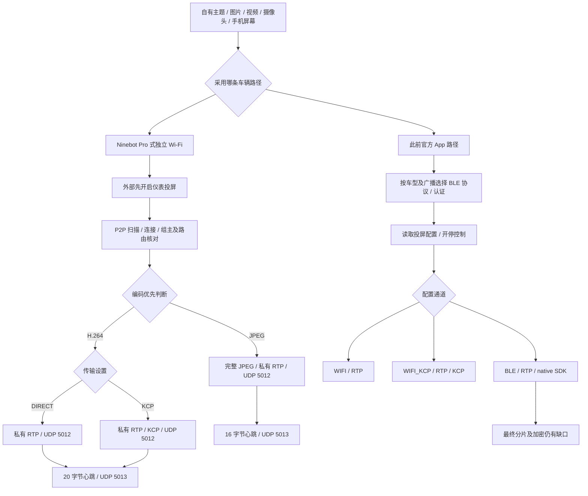

# Ninebot Pro 完整协议分支、官方链路对照与交叉验证

> 2026-11-15续研：[半彩屏BLE完整链路与native复核](九号半彩屏BLE投屏完整链路与Native复核-20261115.md)已补齐官方6.10.11的writeRtpData到GATT出口，确认该路径透传媒体；本文BLE历史对照中的未闭合状态以新报告更新为准。Ninebot Pro自身仍不包含BLE发送。

## 1. 结论与本文的“完整”范围

**Ninebot Pro 自己实现 Wi-Fi 媒体投屏，不依赖九号官方 SO 或向官方 App 注入画面。**现有代码可以完整分出 H.264/RTP、H.264/RTP/KCP、JPEG/RTP 三条发送路径；它没有实现 BLE 车辆认证、BLE 投屏配置读取或 BLE/MPEG2 媒体发送。

本文把 APK 中可见的连接、选择、编码、封包、反馈、异常和停止分支逐项还原；同时列出此前官方链路的 BLE/Wi-Fi/KCP 分支及尚未闭合部分。**没有证据的分支明确保留未知，不把协议树画全等同于全部车型已经打通。**

| 证据层次 | 本次得到的内容 | 可以证明什么 |
| --- | --- | --- |
| 原始输入 | APK、DEX、SO 清单与 SHA-256；固定提交 README、Release 元数据 | 分析的是哪一版、里面实际包含什么 |
| 静态控制流 | JADX 自动输出、fallback 指令、原 DEX 指令、JVM 反汇编 | APK 如何选择分支、构造和处理报文 |
| 原方法执行 | APK 经 dex2jar 转出的打包、解析、KCP、目标核对及配置方法 | 指定输入下这些局部方法的实际输出与状态变化 |
| 独立互通 | APK KCP 方法与上游标准 C KCP 双向分片、重组和 ACK | 本次测试条件下两种 KCP 实现的线协议互通 |
| 车辆验收 | 本轮没有车辆连接、Android 编码实测或仪表 pcap | 不能声称任何新增车型已显示成功 |

本轮共由主代理和三个子代理分支研究，再进行环形交叉审查；复跑他人的测试不重复计为新增覆盖。完整证据入口见第 15 节。

## 2. 输入固定、独立性与 iOS 证据边界

APK 下载经电脑现有代理完成，文件大小 **2,310,026 字节**，SHA-256 与发布页一致：

```text
bd0a0a063fd1966836f97ce3ba2e948a52f6a5a86538dfef78118f7c83ebf94f
```

- [仓库固定提交](https://github.com/xmz28/ninebot_pro/tree/4216b9fef28750ce6ffe3619114d5e4ca8017ae4)：只公开 README 与 funding 配置，没有 Android/iOS 源码。
- [发布页 v0.6.1](https://github.com/xmz28/ninebot_pro/releases/tag/v0.6.1)：Android 8.0+，包名 `com.example.ninebotpro`；R8 已开启。
- APK 只有三个不同的 SO 名称，各含四种 ABI：`libandroidx.graphics.path.so`、`libimage_processing_util_jni.so`、`libsurface_util_jni.so`，属于图形/图像基础设施。可见加载点在 AndroidX；没有九号 `librust_lib.so`、`libnbenc_ffi.so`、`libnbcrypto.so`。
- 媒体发送代码使用 Android MediaCodec、Java RTP/RTCP 构造器、Java KCP 和 DatagramSocket；没有在该路径发现官方 App Hook、LSPosed、Shizuku、官方 APK 动态加载或九号云密钥认证入口。Manifest 也没有 Bluetooth Scan/Connect 等蓝牙权限。

“七寸依据 iOS 成功投屏抓包调整”是作者的说明。仓库没有公开该 iOS App 源码、原始 pcap、抓包时间与仪表固件，因此它只能解释预设来源，不能独立证明 iOS 的连接、认证或七寸报文。本文不会将 Android 的 `WifiP2pManager` 流程等同于 iOS 实现。

此前 NinebotEnhance 的架构是“在九号官方进程中替换画面，再由官方完成认证、编码和发送”；它与此处独立发送器的依赖不同。第三方 APK 的协议观察可作独立实现依据，仓库未给出源码许可证，不直接复制其反编译业务代码进产品。

## 3. 协议和分支总图



编码与承载是两个维度。官方配置里有 MPEG2/H.264/MJPEG，不表示每个仪表支持三者；BLE、NUS/Custom GATT、Encryption2/3、仪表尺寸也不能互相替代为车型判据。

| 独立 APK 预设 | 尺寸 | 默认编码参数 | 实际发送路径 | 作者验收状态 |
| --- | --- | --- | --- | --- |
| 五寸 | 848×480 | H.264，20 FPS，2 Mbps | RTP → UDP | KZ110 曾验证，属于作者自述 |
| 七寸 | 1024×600 | H.264，25 FPS，2 Mbps | RTP → KCP → UDP | Android 仪表实际显示待实测 |
| 4.3 寸 | 480×272 | JPEG，10 FPS，质量80 | JPEG 切片 → RTP → UDP | 手机编码已验证，仪表显示待验收 |

这三个名称是参数预设，不能自动推广为全部同尺寸仪表的协议。

## 4. P2P 建链、路由与车辆认证

### 4.1 连接状态和入口分支

主要证据为 `hd1`、`x32`、`l21`、`dd1`、`vc1`、`uc1`、`MirrorActivity`。本地完整快照在证据目录的 `raw/jadx/`，具体说明见 [连接与认证审计](../../artifacts/ninebot-pro-protocol-20261114/connection-auth/notes.md)。

| 阶段 / 条件 | APK 行为 | 边界 |
| --- | --- | --- |
| 权限 | Android 13+ 附近 Wi-Fi；旧版精确定位；P2P 服务和系统通道须可用 | 权限通过不等于发现了仪表 |
| 选择目标 | 保存完整名称和六段 MAC；构造时 trim，MAC 转小写 | 不按名称前缀或仪表尺寸推断身份 |
| 正在连接/投屏 | 不切换连接目标；同一已核对目标不重复连接 | 会话入口有互斥 |
| 无现存 P2P 组 | discovery + requestPeers；查找上限10秒，约800ms轮询 | 完整名称区分大小写，完整 MAC 忽略大小写 |
| 请求连接 | WPS PBC，`groupOwnerIntent=0`，目标地址为选定MAC | 倾向让仪表作GO，系统可能仍弹确认 |
| 已有目标组 | 重新检查组主和接口后复用 | 不是看到 groupFormed 就开放发送 |
| 自动重连遇其他组 | 保留当前组，提示手动扫描选择 | 启动时尝试最后成功核对的仪表 |
| 组/接口尚未就绪 | 连接过程中约500ms复查 | 总连接等待30秒，超时重置并 cancelConnect |
| 断开/通道失效 | 清连接状态；原投流会话随后停止 | 连接与查询代次号用于忽略过期回调 |

“身份核对”要求手机不是 GO、组主不为空、组主 MAC 匹配，并且 `owner.deviceName` 或 `group.networkName` 等于目标完整名称。它只是名称/MAC 一致性检查，**没有车辆证书、密钥或挑战响应**。

### 4.2 地址与 socket

从 `WifiP2pInfo.groupOwnerAddress` 取得仪表 IPv4；从 `WifiP2pGroup.interface` 对应的接口取得非回环本地 IPv4，并查找同接口名的 Android Network。没有硬编码 `192.168.49.1`。

`o31.c(port)` 的顺序是：创建未绑定 socket → 可用时 `Network.bindSocket` → 绑定本地 P2P IPv4 和该端口 → `connect(GO IPv4,同端口)`。视频用5012、控制用5013；socket read timeout 为1ms，发送缓冲请求262144字节。没有 Network 对象时仍绑定本地接口地址。该网络对象/接口绑定有助于避免投流误走手机默认互联网网络。

### 4.3 到底需不需要车辆认证

| 场景 | 当前判断 |
| --- | --- |
| 仪表已经开启投屏，使用此 APK 的三条 Wi-Fi 发送路径 | 没有在 APK 中发现独立 BLE 车辆认证；它进行 P2P 系统配对和上述目标核对后直接发送 |
| 官方 App 负责开启目标仪表的投屏模式 | 官方 App 可能先完成车辆连接与认证；此 APK 未替代该外部步骤 |
| BLE 半彩屏/MPEG2 | 此 APK 没有覆盖；此前官方 native BLE 路径仍需认证、分片与加密规则证据 |

这也修正了两种过度推论：“所有独立投屏都必须自行实现 BLE 认证”以及“九号投屏一律不需要车辆认证”。两者都超出了已有证据。

## 5. 配置、画面源和有效分支

### 5.1 配置格式与选择优先级

`d02` 的顺序为 `width,height,fps,bitrate,rotation,scale,codec,jpegQuality,transport`。兼容6、8、9字段：

- 6字段：旧配置，回落 H.264、JPEG质量80、DIRECT。
- 8字段：显式编码和质量，仍回落 DIRECT。
- 9字段：再指定 DIRECT 或 KCP。

所以仅把旧七寸配置改成1024×600不会自动启用 KCP。配置按 MAC 存入本地 `profile_<MAC>`，是显示参数，不是车辆授权凭据。无配置或解析失败时，大多数目标缺省五寸 H.264；APK 对一个内置精确名称+MAC测试目标特选 JPEG。**这是硬编码特例，没有自动识别全部4.3寸或七寸仪表。**

通用约束：宽高均为64..1920的偶数，总像素不超过2073600；帧率5..30；码率250000..8000000；旋转0/90/180/270；JPEG质量30..95。缩放为保留完整、裁满、拉伸。JPEG 中码率字段虽存在且被校验，实际压缩使用质量参数，没有以该码率限速。

实际选择顺序必须写成：

```text
codec == JPEG  → o31.b → JPEG / DIRECT，立即返回
codec == H264 → transport == KCP ? H264/RTP/KCP : H264/RTP
```

JPEG+KCP 可以出现在存储配置中，`d02.F()` 也原样返回KCP，但发送器优先进入JPEG分支并忽略它。诊断应报告有效传输，不能只显示存储枚举。

### 5.2 画面源与生命周期

| 源 | APK 路径 / 行为 |
| --- | --- |
| TEST | 本地生成测试图，经与所选预设相同的编码和发送路径 |
| IMAGE | 图片解码后进入最新 Bitmap 槽，再缩放/旋转 |
| VIDEO | 视频画面进入最新帧槽，有前台预览及后台帧服务；声音在手机播放 |
| CAMERA | 需相机权限；App 离开前台后停止该源 |
| SCREEN | MediaProjection 授权与前台服务采集手机屏幕 |
| SELF_TEST / 本机探测 | 无 P2P 对端、不创建媒体socket；可写本地媒体文件，约3秒结束 |

TEST/SELF_TEST 走测试图源，其他源经统一 Canvas/Bitmap 接口。保存旧 Bitmap 时 JPEG 可以重复压缩旧画面，所以编码FPS不等于新采集FPS。自检日志和封包计数也不等于实际网络发送；无 socket 路径仍可能增加计数。

## 6. H.264 编码与完整访问单元

此分支适用于五寸 DIRECT 与七寸 KCP，两者共用编码、RTP与20字节控制逻辑。

1. 请求系统 `MediaCodec video/avc`，优先 Bitmap→OpenGL→encoder Surface；失败释放资源后尝试 flexible YUV420 和 CPU ARGB→YUV 转换。不能找到可用编码器或输入 Image 时失败退出。
2. 申请 Baseline、1秒I帧间隔、预设FPS/码率；Android29+申请零B帧，priority=0、latency=1。按宏块预算申请 Level3/3.1/4。以上是请求值，未实测所有编码器是否按请求输出。
3. 同时在途输入PTS少于2时才取新图；到预定时刻且画面变化，或静止画面达到保活间隔才送帧。约每500ms在准备取帧时请求IDR。不是无条件每500ms都能产出IDR。
4. 格式改变时读取 csd-0/1；codec-config输出单独缓存；partial-frame输出拼接成完整AU，各片PTS不同会失败。
5. 关键帧由编码器标志或NAL type5判断；缺SPS或PPS时前置缓存，合并后仍缺则失败。关键帧发送前必须有完整参数集。
6. Annex B 输入按3/4字节起始码接受；否则只支持四字节大端NAL长度列表，转成四字节起始码。零长度、越界和不完整长度失败。不是完整 avcC 解析器，也没有覆盖1/2/3字节NAL长度字段。

线上RTP timestamp为 `max(0,(本完整AU的PTS-首个完整AU的PTS)/1000)`，单位毫秒，取低32位；不能换成90kHz或手机墙钟而声称完全等价。

详见 [H.264/RTP 审计与指令证据](../../artifacts/ninebot-pro-protocol-20261114/h264-rtp/notes.md)。本轮执行了封包/NAL处理方法，没有在桌面运行 Android 编码器和采集服务。

## 7. H.264 私有 RTP 的字节规范

`sd.l` 对完整AU直接切片，每片媒体最多1380字节，加20字节头，**UDP负载最大1400字节**。没有 RFC6184 FU-A/STAP-A 包装；其中PT32也不是通常的动态H.264负载类型。

| 偏移 | 长度 | 内容 |
| --- | --- | --- |
| 0 | 1 | `90`：RTP v2，X=1，CC=0 |
| 1 | 1 | PT32；尾片置Marker，即`a0`，其他`20` |
| 2 | 2 | sequence，大端低16位；每会话从0开始 |
| 4 | 4 | timestamp，大端低32位；同一AU的分片相同 |
| 8 | 4 | SSRC全零 |
| 12 | 2 | 扩展profile ID全零 |
| 14 | 2 | `00 01`：1个32位扩展字 |
| 16 | 1 | `00` |
| 17 | 1 | `(key?1:2) \| (first?0x10:0) \| (last?0x08:0)` |
| 18 | 2 | 小端 `0x400 \| (timestamp & 0x3ff)` |
| 20 | ≤1380 | AU原字节切片 |

| 帧类型 | 单片 | 多片首 | 多片中间 | 多片尾 |
| --- | --- | --- | --- | --- |
| 关键帧 | `19` | `11` | `01` | `09` |
| 非关键帧 | `1a` | `12` | `02` | `0a` |

这是本次明确修正的反编译问题：JADX自动结果将第17字节错误恢复为布尔比较；fallback中的整数OR指令及原方法输出均证实上表。18..19只是时间低位派生值，不能命名为独立帧号。

关键帧重复开关默认打开：仅当 `key && repeat` 时，将完整AU的所有分片按相同timestamp发两遍；第二遍sequence继续增加。这是应用层重复，和KCP重传分别生效；空帧不发。序号回绕只取16位。

原方法合成向量：sequence=`1234`、timestamp=`12345678`、关键帧、不重复、payload=`00`：

```text
90 a0 12 34 12 34 56 78 00 00 00 00 00 00 00 01 00 19 78 06 00
```

此payload用于字段验证，不是可解码H.264视频。

## 8. H.264 控制、反馈与停止

### 8.1 20字节请求和严格回复模板

5013每约1秒发送一次，首个index为1。小端index示例 `01020304`：

```text
请求：85 cc 00 04 00 00 00 00 00 00 00 00 04 03 02 01 02 00 00 00
可识别回复模板：
      85 cc 00 04 00 00 00 01 00 00 00 00 04 03 02 01 02 00 00 00
```

`sd.i` 只接受长度恰为20、SSRC=1、名称位置为零、末尾mode=2的这一格式。请求自己的SSRC为0，因此不能将它直接回显当成匹配回复；16字节`mpv`和24字节反馈都被拒绝。返回的32位index有符号，`ffffffff`与失败哨兵-1冲突。

每轮最多读8个控制包，缓冲2048；最多保留最近8个请求时间，匹配index才统计回复和RTT，其他包只输出长度及前48字节。**没有发现无回复停发、根据反馈调整FPS/码率、切模式或更新KCP conv的控制分支。**作者提到七寸24字节反馈未被识别，与此实现相符，但本轮没有该原始仪表包可分析其内容。

### 8.2 停止与错误

停止标志、源/编码/网络异常均进入资源释放；无对端自检约3秒正常结束。清理时向5013尝试发送 `80 cb 00 00`，随后关socket、编码器、EGL/Surface、Bitmap、文件和图源。这个4字节PT203包没有SSRC列表，不能保证所有接收端都将其视为有效BYE；没有停止回执等待，也没有等待KCP全部ACK后才关闭的流程。

## 9. 七寸 KCP 完整分支

### 9.1 层次和参数

```text
完整 H.264 AU
  → 最多1380媒体字节 + 20字节RTP头
  → 每一个完整RTP包作为一个KCP message
  → KCP分段 / UDP5012
```

| 参数 | Ninebot Pro 的实际值 |
| --- | --- |
| conv | 固定3，成员为final；没有从5013回复更新它 |
| MTU / MSS | 1400 / 1376，即24字节KCP头 |
| nodelay / interval | 1 / 10ms |
| fastresend / nocwnd | 2 / true |
| 本地发送窗 / 接收窗 | 256 / 256 |
| 初始对端窗口 | 128，收到ACK等输入后可以改变 |
| 初始RTO / 最小RTO | 200ms / 30ms |
| 输入处理 | 每轮最多16个5012数据报，单包读取缓冲2048，随后update/flush |

10ms是KCP更新间隔配置，主循环受编码、来源和socket处理影响，不能据此承诺实际每10ms准时flush。

### 9.2 KCP线上头

多字节字段均为小端；一个UDP包可以合并多个KCP segment：

| 偏移 | 长度 | 字段 |
| --- | --- | --- |
| 0 | 4 | conv，固定3 |
| 4 | 1 | cmd：81 PUSH / 82 ACK / 83 WASK / 84 WINS |
| 5 | 1 | frg，当前message后续剩余段数 |
| 6 | 2 | wnd，当前可用接收窗 |
| 8 | 4 | ts，KCP计时毫秒，独立于RTP timestamp |
| 12 | 4 | sn，KCP段序号，独立于RTP sequence |
| 16 | 4 | una，本端期望接收对端的下一个连续SN，即对其发送流的累计确认界限 |
| 20 | 4 | 当前段payload长度 |
| 24 | 变长 | 完整RTP包的某一段 |

一个最大1400字节RTP message分为1376和24字节两段：单独输出时UDP长度分别1400、48，frg分别1、0。仪表需要先KCP重组回完整RTP，再按RTP重组媒体。不能把KCP段直接作为H.264片或把frg当RTP片号。

### 9.3 ACK、重传与特殊状态

- 错conv、不支持的cmd、声明payload越界被拒绝，不会因此切换会话。
- ACK和una清理发送缓存并更新对端窗口；两次较高sn的ACK可触发遗漏段快重传；RTO超时也重传，nodelay模式下该路径按约1.5倍增加RTO。
- 零对端窗暂停数据发送并保留队列；约7000ms开始WASK探测，收到探测可回WINS。
- 5012 KCP ACK与5013控制统计是两条独立接收路径；5013没有匹配回复不表示5012没有ACK。

### 9.4 已执行确认的实现缺口

| 情况 | 原方法观察 | 正式实现的影响 |
| --- | --- | --- |
| 持续编码但没有ACK | 初始发送缓存受对端128窗限制，待发队列仍持续增长 | 需AU级有界背压与重建策略，不能以窗口大小当总队列上限 |
| 长期RTO重传 | 测试30轮超时后仍发送，未找到dead-link/最大重传终止 | 需有限恢复和失败状态 |
| 入站PUSH | 内核ACK并保留接收数据，调用方没有消费媒体的recv流程 | 当前主要作发送端；不能据此当双向应用消息栈 |
| KCP序号到32位回绕 | long计数与wire低32位存在比较边界；专项测试发现选择性ACK和接收推进异常，累计una有不同结果 | 不应把此手写内核当成熟、全边界覆盖的KCP库 |
| 用户停止 | 直接结束socket/会话 | 不保证所有排队媒体已到达 |

上述是测试到的发送器行为，并非对仪表接收端的推测。另执行了原`sd.l`到KCP队列的29组关联场景：每个RTP独立入队，按1376字节分段；分段数必须严格小于发送窗，否则丢弃该RTP，但仍消耗RTP序号并调用update。这里的`ks0/js0`为容器桩；KCP内核另用原类和上游C验证，两组实验均未执行完整Android主循环。

### 9.5 与标准 KCP 的独立互通

固定上游 [skywind3000/kcp 提交](https://github.com/skywind3000/kcp/tree/7346e366f1928dd727ecbb53253454fdaecaebb7)，编译原`ikcp.c/h`为独立C端：APK原`ks0`产生的分段可被其重组并ACK；反向C端发送两段，APK内核接收并回ACK，C端未确认数归零。共13项互通断言通过。

此结果闭合了受测条件下KCP格式和双向ACK兼容性，**没有验证某块七寸仪表要求conv=3、实际显示或丢包性能**。完整状态、向量、上游文件哈希见 [KCP审计](../../artifacts/ninebot-pro-protocol-20261114/kcp/notes.md) 和 [互通结果](../../artifacts/ninebot-pro-protocol-20261114/kcp/interop-validation.json)。

## 10. 4.3 寸 JPEG 完整分支

### 10.1 编码与调度

按预设尺寸在ARGB_8888 Bitmap/Canvas绘制，`Bitmap.compress(JPEG,quality,stream)`逐帧编码；失败退出。帧间隔约为round(1000/FPS)，严重迟到时从当前时间重新排下次，不无限追赶旧帧。没有JPEG关键帧复制、KCP重传或按bitrate字段限速。

每会话随机32位媒体SSRC，另取随机32位timestamp起点`T0`。每帧timestamp=`(T0+单调经过毫秒)&ffffffff`；sequence从0开始。与H.264的SSRC零和相对首输出PTS不同。

### 10.2 JPEG/RTP

只验证总长度≥4、开头`ff d8`、结尾`ff d9`；不检查JPEG内部标记、量化表或实际可解码性。四字节`ff d8 ff d9`在原方法中也能通过，测试不能把这种输入当有效图片。

完整JPEG含SOI/EOI，媒体每片最多1400字节，再加20字节头，**UDP负载最大1420字节**。

| 偏移 | 内容 |
| --- | --- |
| 0..7 | 与前述RTP外形相同：`90`、PT32/尾片Marker、sequence BE16、timestamp BE32 |
| 8..11 | 随机会话SSRC，BE32 |
| 12..15 | `00 00 00 01`，扩展ID0、1个32位扩展字 |
| 16..19 | 固定`00 01 00 00`；不包含H.264的首末片标志和时间低位字段 |
| 20..末尾 | JPEG原字节分片，最多1400 |

不是RFC2435的JPEG RTP payload头，也不是PT26。接收端实际如何处理丢片、重复、未完整帧仍未知。已测试4/1399/1400字节为1包，1401/2800为2包，2801为3包，并重组核对原输入。

`g71`的SR统计只计媒体包及媒体payload字节；外部数组计完整数据报字节，二者口径不同。停止或发送失败可能消耗序号但不增加该失败包的SR统计；无socket自测仍累计计数。

### 10.3 心跳不匹配的准确含义

JPEG每约1秒发16字节`mpv\0`心跳，首index为0：

```text
85 cc 00 03 00 00 00 01 6d 70 76 00 II II II II
```

但它复用`sd.i`，只接受第8节的20字节零名称/mode2回复。原方法执行已确认：16字节请求/回显被拒绝，特定20字节模板可识别，24字节被拒绝。

**这证明发送格式与解析约束不同，不证明仪表一定返回16字节回显。**必须拿到仪表真实反馈才能确认哪个回复受影响。JPEG同样只用匹配反馈统计RTT，不据此停发或调参。这个诊断限制不只影响七寸。

### 10.4 停止和72字节SR/BYE

正常停止、自检结束或异常清理时，仍有5013 socket则尝试发送`g71.a`，失败后继续释放资源：

| 偏移 | 内容 |
| --- | --- |
| 0..3 | `80 c8 00 06`：无接收报告的SR，28字节 |
| 4..7 | 同媒体随机SSRC，BE32 |
| 8..15 | NTP秒及fraction，来自Unix毫秒转换 |
| 16..19 | 最后RTP timestamp，BE32 |
| 20..27 | 媒体包数和媒体payload字节数，BE32 |
| 28..31 | `81 cb 00 0a`：1个SSRC的BYE，44字节 |
| 32..35 | 同媒体SSRC |
| 36..57 | 原因长度21、ASCII `jlibrtp says bye bye!` |
| 58..71 | 14字节全零 |

总长度28+44=72自洽，但该原因长度通常只需2个对齐零；这里还有额外零，复合包也没有SDES/CNAME。文档记录实际字节，不能称为已验收的完整标准RTCP会话，也不能仅凭标准差异断言仪表拒收。没有停止回执或周期性完整接收质量协商证据。

细节与原类执行结果见 [JPEG审计](../../artifacts/ninebot-pro-protocol-20261114/jpeg/notes.md)。

## 11. 与此前官方 App 协议的全部已知分支对照

### 11.1 认证选择和协议头

这部分是对此前固定九号App 6.10.11研究的复核，不是声称从Ninebot Pro还原了官方认证。

| 官方选择维度 | 已确认分支 / 边界 |
| --- | --- |
| 基础protocol=1 | 认证版本2选择`BleEncryption2Protocol1`，其他选`BleProtocol1` |
| 基础protocol=2 | 版本2选`BleEncryption2Protocol2`；版本3选`BleEncryption3Protocol2`；其他走`BleProtocol2`，存在encrypt=0关闭加密分支 |
| 基础protocol缺失/未知 | 官方方法回落Encryption2Protocol2；第三方不能把缺失字段当已确认认证版本 |
| GATT | NUS与Ninebot Custom通道是承载选择，不能按Gen3名称直接决定 |
| 普通BLE命令 | `5A A5`构型，Encryption2有PRE_COMM/SET_PWD/AUTH及认证后会话；目标板地址需按车型确定 |
| Wi-Fi控制类 | `5A B5`两字节长度/索引；类存在不证明媒体采用此头 |
| 扩展BLE命令 | `AA 55`两字节长度/索引，可与普通命令共存；不是已证明的统一视频头 |
| V3Auth | Java选择器、native连接入口、云密钥及进度回调已知；完整challenge、派生、nonce/tag和逐包时序未闭合 |

MMAX90实车旧抓包只确认扫描、GATT、加密框架和PRE_COMM，不含干净的首次SET_PWD/AUTH全过程。PRE_COMM目标0x09也不能推广到全部九号设备。V3Auth的物理连接回调不等于最终认证成功。

详细历史依据：[Gen3/认证研究](九号Gen3与2025后车型蓝牙握手深度研究-20261009.md)、[MMAX90 Gen2](../ble/ninebot-mmax90-gen2-protocol-analysis.md)。

### 11.2 官方投屏开停和配置读取

官方`setNaviStart` payload：`00`停止、`01` SimpleNavi、`02` MapNavi、`03` Cruise。Mmax2/N3/Mz对照命令表中在tft、命令0x71/index0；不是全部车型通用地址，也不能把此处02与APK心跳的mode2视为同一个协议字段。

投屏配置是type1文件，缓存名`<SN>_screen_cast_config.nb`。可先比较MD5命中缓存；否则按`file_read_begin=130`（index1、payload `01 08 00`）、`file_read_data=131`分组读取、`file_read_verify=132`校验。每组最多8个128字节单位、按顺序收包；文件长小端，校验响应16字节MD5。MD5只用于文件一致性，不替代车辆认证。

此前还原的等待/重试为开始/校验1000ms、数据组4000ms；通用写最多6次尝试、间隔300ms；数据组外层最多7次。乱序和超时恢复不是任意包重组，正式实现还需要长度/状态边界。完整参数与原类哈希见 [历史证据摘要]（本地来源，未随附原始材料）。

### 11.3 配置 → 编码与承载

| 配置 | 官方行为 | 对第三方的限制 |
| --- | --- | --- |
| `rtpChannel`有效 | 优先使用 | 不只看`channel` |
| `rtpChannel`无效 | 再看`channel`，仍无效回落BLE | 回落不证明目标实际支持BLE投屏 |
| 通道`0/1/2` | BLE / WIFI / WIFI_KCP | 三个独立sender分支 |
| `codecType=0/1/2` | MPEG2 / H.264 / MJPEG | 编码可选不等于各仪表全支持 |
| 无有效codecType | 尝试codecName，未知编码失败 | 不随意改成H.264宣称兼容 |
| 尺寸 | codecWidth/Height → dimensionWidth/Height → 240×320 | 缺省尺寸不是某车型已知尺寸 |
| 其他视频参数 | bitrate、GOP、B帧、FPS进入编码配置 | hearBeat/rtcpChannel等字段不一定被该builder使用 |

### 11.4 媒体和控制的差异

| 项 | Ninebot Pro H.264 | Ninebot Pro JPEG | 既有官方Wi-Fi证据 |
| --- | --- | --- | --- |
| 媒体切片 | 1380+20 | 1400+20 | 1400+20 |
| 媒体SSRC | 0 | 随机 | 本地发送随机，不能误用对端Participant=1 |
| RTP扩展 | 首末位/帧型/时间低位 | 固定picture type1 | frameType==2→1，其余2 |
| timestamp | 相对编码PTS毫秒 | 随机初值+单调毫秒 | 系统墙钟毫秒低32位 |
| 心跳 | 20B、零名称、mode2 | 16B `mpv\0` | 16B `mpv\0` |
| 反馈处理 | 严格20B、只统计 | 同一严格20B解析器 | APP subtype1..5，有质量/FPS/码率/mode/conv处理 |
| KCP | 固定conv3、MTU1400、10ms、窗口256 | 无 | conv0起步，可由反馈更新；MTU1444、`nodelay(2,100,2,1)`、窗口10240 |
| 心跳失联 | 未发现停发门控 | 未发现停发门控 | 超时回调存在禁发逻辑，不能照搬APK纯统计行为 |

既有官方Wi-Fi KCP仍使用native `libkcp.so`，其Java参数不证明所有内部行为与上游完全相同。APK采用Java内核，二者不应混称为同一份实现。

### 11.5 BLE/MPEG2 和 native 的未闭合边界

官方旧Java BLE RTP沿用20字节头，但PT缺省0、媒体片长`device.getMtu()-27`、最多20次发送尝试。2026-11-15已进一步核实，SDK getter在正常协商ATT MTU后先减3，不能直接把原始ATT值代入这里的M；详见新报告。仅失败且尚有重试时等待2ms，不能理解为每个成功包都限速2ms。旧特征路径区分RTP写、RTCP写和RTCP通知。

使用SDK时走`NbBluetoothDevice.writeRtp → BleSdkClient.writeRtpData → RustBridge.writeRtpData → Rust native SDK`。2026-11-15续研已补齐具体future、boxed writer与GATT出口：这条路径保持原RTP字节，不在native再次封装或逐包加密；详细版本、调用图和局部原函数验证见上述新报告。另有`sendRtcp=false`分支直接返回true而不发送，不能把库中存在心跳线程当作所有投屏入口都发BLE心跳。

“全彩/半彩”不是加密算法开关。BLE认证加密、Wi-Fi链路保护、媒体应用层加密应分别建模。该APK的媒体方法直接复制压缩字节进RTP/KCP，没有该路径的额外应用层AES步骤；这个观察不能否定其他官方BLE媒体或其他车型存在加密。

## 13. 验证矩阵与交叉审查

| 执行单元 | 结果 | 实际覆盖 | 未覆盖 |
| --- | --- | --- | --- |
| 连接/配置原方法 | 34断言通过 | 完整名称/MAC、组主角色、networkName后备、generation、6/8/9字段及参数边界 | Android系统建组及系统权限弹窗 |
| H.264/RTP原方法 | 210组场景、5103断言通过，其中29组关联KCP入队 | 1380/1376边界、位字段、关键帧复制、16/32位回绕、心跳、NAL转换、停止、原sd入队 | 真正MediaCodec输出和仪表解码 |
| JPEG原方法 | 151断言通过 | 1400边界、重组、SSRC、心跳不匹配、SR/BYE、取消/异常/无socket计数 | Android JPEG压缩、JPEG内容解码和仪表显示 |
| KCP原内核方法 | 24项通过 | ACK/una、快重传/RTO、窗口、队列、探测、错误输入、32位回绕边界 | 完整Android主循环与车端性能 |
| 上游C KCP互通 | 13项通过 | 双向分段重组、ACK清缓存，独立实现交叉核验 | 七寸conv取值和实际显示 |

交叉审查链为 H.264代理→JPEG，JPEG代理→KCP，KCP代理→H.264；主代理核对公共配置/认证和历史官方证据，再由H.264代理审查连接结论、KCP代理复核总文档。审查包括读原指令/反汇编、复跑对方方法或互通工具，并单独写出覆盖限制。210组包含29组KCP对照所用的DIRECT基准，不能再相加为239组独立场景。

方法限制：JADX自动输出报96个错误，因此关键方法使用fallback/原DEX复核。dex2jar转换类缺JVM stackmap，测试使用`-Xverify:none`；H.264测试移除无关静态初始化但保留目标方法。连接测试绕过Android构造，使用值对象/枚举桩；实际枚举的转换初始化曾触发`java.lang.Enum`实例化错误，已记录并用值桩隔离。**这些测试是局部字节逻辑的离线验证，不是整个APK在JVM或Android上已经运行成功。**

## 14. 已闭合问题与仍需的实车证据

| 问题 | 本轮状态 |
| --- | --- |
| 是否依赖九号官方SO/Hook | 独立Wi-Fi媒体路径已确认；SO清单及发送代码一致 |
| 三种预设是否只是尺寸差异 | 已否定；编码、片长、SSRC、扩展、时间戳、控制和KCP均存在分支 |
| H.264第17字节到底怎样构造 | 已由DEX与原方法输出闭合 |
| 5013无统计是否意味着失败 | 不成立；解析器拒绝多种长度，且未据此停发；真实反馈内容仍未知 |
| KCP是不是标准可互通 | 受测格式及双向ACK与固定上游互通；完整边界仍有实现缺口 |
| 七寸能否通用固定conv3 | 未闭合，需真实5013/5012会话和画面 |
| 4.3寸是否实际显示JPEG | 未闭合，作者与本轮都没有提供仪表验收证据 |
| 能否省掉所有车辆认证及外部开启 | 未闭合，按车型核验开启投屏前提 |
| BLE/MPEG2和V3Auth能否完全独立实现 | 当前证据不完整，不能由Wi-Fi三预设推出 |
| 是否已有可读iOS实现/原pcap | 未取得；README描述不足以还原iOS协议 |

下一轮应分别保留五寸DIRECT、七寸KCP、4.3寸JPEG的完整会话：仪表型号/固件、打开投屏前后、P2P建组、开始/停止、静态与动态画面、5012/5013双向包，以及配对/重连/异常恢复。七寸必须保留24字节反馈原文、conv、KCP ACK与实际显示时间；JPEG必须验证接收端重组、真实图像解码及丢片表现。BLE路径另需对应配置与HCI/native数据边界，不能由Wi-Fi抓包代替。

## 15. 证据索引与复跑入口

### 15.1 本轮材料

- [证据目录说明与复跑](../../artifacts/ninebot-pro-protocol-20261114/README.md)
- [APK/Dex/SO/源快照哈希索引]（本地来源，未随附原始材料）
- [连接/认证/配置笔记](../../artifacts/ninebot-pro-protocol-20261114/connection-auth/notes.md)、[原方法验证](../../artifacts/ninebot-pro-protocol-20261114/connection-auth/validation.json)
- [H.264/RTP笔记](../../artifacts/ninebot-pro-protocol-20261114/h264-rtp/notes.md)、[验证结果](../../artifacts/ninebot-pro-protocol-20261114/h264-rtp/validation.json)
- [KCP笔记](../../artifacts/ninebot-pro-protocol-20261114/kcp/notes.md)、[内核验证](../../artifacts/ninebot-pro-protocol-20261114/kcp/validation.json)、[上游互通](../../artifacts/ninebot-pro-protocol-20261114/kcp/interop-validation.json)
- [JPEG笔记](../../artifacts/ninebot-pro-protocol-20261114/jpeg/notes.md)、[验证结果](../../artifacts/ninebot-pro-protocol-20261114/jpeg/validation.json)
- [H.264复核JPEG](../../artifacts/ninebot-pro-protocol-20261114/h264-rtp/cross-review-jpeg.md)、[JPEG复核KCP](../../artifacts/ninebot-pro-protocol-20261114/jpeg/cross-review-kcp.md)、[KCP复核H.264](../../artifacts/ninebot-pro-protocol-20261114/kcp/cross-review-h264.md)、[连接结论复核](../../artifacts/ninebot-pro-protocol-20261114/h264-rtp/cross-review-connection.md)、[总文档KCP复核](../../artifacts/ninebot-pro-protocol-20261114/kcp/cross-review-main.md)

APK、转换jar和主输入快照保存在Git忽略的本机`raw/`；分支的fallback工作副本和交叉复跑产物也已忽略。正文、哈希、工具源码和验证记录可审阅。原始类名在DEX中属于默认包，`defpackage`只是JADX展示目录，不是协议API名称。

### 15.2 历史证据与现有实现
