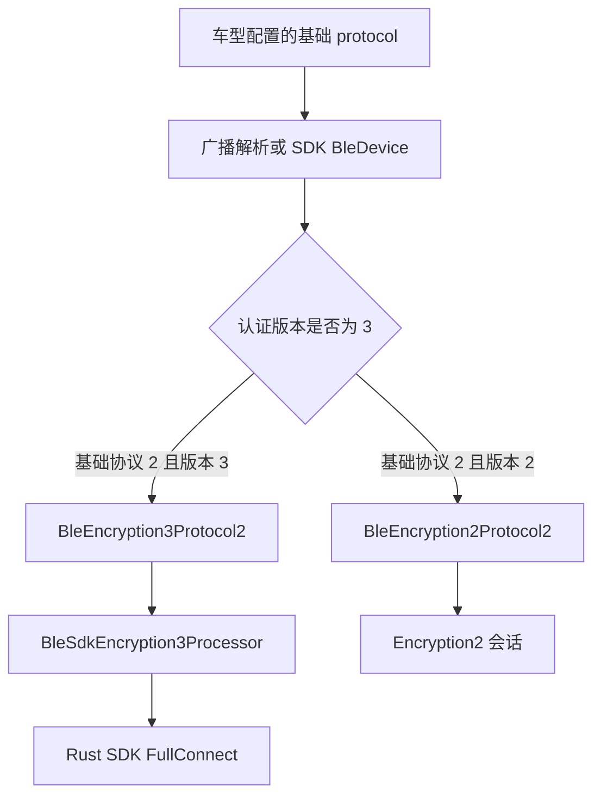

# 九号 Gen3 与 2025 年后车型蓝牙握手深度研究

> 研究日期：2026-10-09。续接九号 BLE 数据读取、MMAX90 握手及 2026-09-22 的加密研究。  
> 范围：用户所称 Gen3、新款车型的协议选择、认证、帧格式和只读遥测；本轮没有实车。  
> 证据：root HT2 上的九号出行 6.10.11、官方 APK、官方运行时车型目录和本地配置、开源项目的固定版本。  
> 本文是研究结果，不是已完成的 Gen3 客户端，也不是新车型实车兼容性声明。

## 1. 本轮结论

1. **不能把开源项目的 `gen3`、官方 Encryption3/V3Auth、车型名称 MAX G3 当成一个概念。**开源 `gen3` 使用 `5A B5`，但其握手仍是 Encryption2 的 PRE_COMM / SET_PWD / AUTH。官方 BLE Encryption3 继承 `5A A5` 帧格式；官方 `5A B5` 属于 Wi-Fi 协议类。
2. **2025 年后的车型不能靠年份自动选择认证代际。**官方 App 用车型配置确定基础协议，再读取广播得到 `encryptProtocolVersion`。基础协议 2 且广播版本 3 才选择 `BleEncryption3Protocol2`。
3. **本机运行时目录的 131 个车型没有一个默认配置写 `encrypt=3`。**其中包括 MAX G3、F3、GT3、MAX G3 Pro 以及 Fz/Mz 系列。这不证明这些车型实车都用 Encryption2，因为认证版本可以由广播覆盖。
4. **V3Auth 确实存在云端密钥、有效期、SDK 激活和密钥分发流程。**本轮取得了具体 API、响应字段、native 注入格式和错误码。它已不只是“native 字符串中出现 V3”。
5. **新车型的读取地址不能沿用 MMAX90。**官方 MAX G3/F3/GT3 的 `vcu` 是 `0x16`；开源车型命令配置的速度候选是 `vcu:0x57`，而 Mmax2/N3/Mz 的官方缓存采用 `dis:0x26`。
6. **`AA 55` 是官方支持的另一种扩展命令帧。**它有两字节长度和索引，并由单条命令的 `proto=AA55` 选择，不是 Encryption3 的唯一帧头，也不能据此判断视频加密。
7. **独立 V3Auth 仍未达到可实现、可验收状态。**缺少真实 challenge、密钥分发、最终认证交互、精确密码学转换和计数器测试向量。不能通过把 `A5` 改成 `B5` 或替换寄存器来补齐。

## 2. 材料、采集和证据等级

### 2.1 官方 App 的固定版本

| 项目 | 值 |
| --- | --- |
| 包名 | `cn.ninebot.ninebot` |
| versionName | `6.10.11` |
| versionCode | `610114116` |
| ABI | `arm64-v8a` |
| APK SHA-256 | `02ecd91b74e00df76cfe00eda4c4a9a5bc332231562a171e48d64f45bd418705` |
| 实车 | 无 |

APK 的设备端和本地 SHA-256 一致。App 在取证前已经运行；本轮通过 root 读取公开车型配置，通过临时 Frida 会话访问配置缓存、调用本地配置解码和广播解析函数。没有发起车辆连接、认证、SET_PWD 或车辆控制，也没有调用云端密钥 API。

运行时取证限定在车型配置对象、配置解码及合成广播；没有导出账号数据库、登录令牌或实际车辆认证密钥。解码使用 App 自身已有的配置解密上下文，配置密钥没有导出到证据摘要。临时 Frida 会话、服务和 ADB 转发已结束；九号 App 进程仍保持运行。

### 2.2 参考代码版本

| 来源 | 固定版本 | 用途 |
| --- | --- | --- |
| `tools/third_party/segway-ninebot-ble-app` | `d26b181c1d7eda8e11248af53a6a622334746d9a` | 核查开源 `gen3`、握手、车型寄存器配置 |
| `tmp/segway-ninebot-ble` | `015492ef5af260bbfe2c519a44413afbd15687f4` | 核查协议文档与客户端命名冲突 |
| 九号官方 APK/运行时缓存 | 上述 APK SHA-256 | 协议选择、帧构建、V3 密钥流程、模块表 |

证据等级采用：

- **官方运行时验证**：HT2 中读取到对象或调用了官方函数；仍不是车辆互通验证。
- **官方静态确认**：可追踪的 Java 调用、常量和字段；反编译失败的方法不能视作完整实现。
- **开源配置候选**：来自参考项目的型号命令表，需要官方配置或实车进一步确认。
- **native 字符串线索**：用于定位状态机；不能单独证明报文顺序或算法。

机器可读摘要保存在 [evidence-summary.json]（本地来源，未随附原始材料），包含 15 个重点车型配置、3 份官方命令配置的摘要和哈希、3 份滑板车参考配置、5 个官方解析器验证向量，以及 native/反编译证据文件哈希。摘要不包含实际密码、会话密钥或令牌。

## 3. Gen3 的三种含义

| 名称 | 本轮确认的含义 | 不能据此推出 |
| --- | --- | --- |
| 开源 `ProtocolGen.gen3` / CLI `--gen 3` | `sync2=0xB5`、部分控制指令换目标、初始 key2 改成 null | 已实现官方 BLE V3Auth |
| 官方 Encryption3 / V3Auth | 基础 BLE Protocol2，认证版本 3，交给 native SDK | 所有 2025 后车型都采用它 |
| 车型 MAX G3 / GT3 / F3 | 产品名称或系列名 | 名称中的 3 等于认证版本 3 |

开源 Dart 的 `handshake.dart` 明确写着“三阶段 Encryption2 握手”；`gen3` 只改变初始 key2 和帧参数。Python CLI 同时把广播认证版本 3 标为 `NOT supported`。因此其“Full Gen2/Gen3”说明与“完整官方 V3Auth”不是同一个支持范围。

更直接的冲突是：开源 `gen3` 仍把 LENGTH 和 INDEX 写为一字节，却把帧头换成 `5A B5`；官方 `WifiEncryptionProtocol2` 的 `5A B5` 使用两字节 LENGTH、两字节 INDEX 和另加校验。它连完整的官方 Wi-Fi v2 帧结构也不能仅凭这个枚举名来保证。

## 4. 官方协议选择：车型基础配置 + 广播认证版本

`DynamicDevice.encryptProtocolVersion()` 在使用 Rust SDK 时读取 `BleDevice.encryptProtocolVersion`，旧路径读取 `ScanRecord`，缺失时返回 2。

`DynamicDevice.createBleProtocol()` 的主要分支为：

| 车型基础 protocol | 运行时认证版本 | 实际创建的类 |
| --- | --- | --- |
| 1 | 2 | `BleEncryption2Protocol1` |
| 1 | 其他 | `BleProtocol1` |
| 2 | 2 | `BleEncryption2Protocol2` |
| 2 | 3 | `BleEncryption3Protocol2` |
| 2 | 其他且车型 `encrypt=0` | `BleProtocol2`，显式关闭加密 |
| 2 | 其他 | `BleProtocol2` |
| protocol 缺失或非 1/2 | 任意 | 该方法回落到 `BleEncryption2Protocol2` |

这张表描述 6.10.11 的真实分支，不建议把它的缺省回落作为第三方客户端的安全推断规则。缺失广播数据时，第三方客户端应保留“认证版本未知”，而不是宣称已确认 Encryption2。



扫描重连路径先更新设备的 `BleDevice`，再检查 `isSuportV3Auth()`：版本 3 使用 `connectFull()`；其他设备进入 `connectGetSN()`。这进一步表明同一车型目录条目可以遇到不同的运行时认证版本。

## 5. 广播识别：不能只看名称和一个版本字节

### 5.1 三种官方 Manufacturer Data

官方 Java `ScanRecord` 对 Manufacturer ID 使用大端读取；BLE 库把 Company ID 按标准小端转换成整数后，数字会不同。应优先保留原始字节。

下表的 payload 指去掉两个 Manufacturer ID 字节后剩余的数据：

| 原始 ID 字节 | Java 看到的 ID | 小端 API 常见整数 | payload 中的版本位置 |
| --- | --- | --- | --- |
| `4E 42` | `0x4E42` / 20034 | `0x424E` / 16974 | offset 1 |
| `4E 43` | `0x4E43` / 20035 | `0x434E` / 16975 | offset 2 |
| `1F 0F` | `0x1F0F` / 7951 | `0x0F1F` / 3871 | offset 0 的低四位 |

三种格式都检查 payload 末字节：

```text
checksum = ~(sum(payload_without_checksum)) & 0xFF
```

`4E 42` 格式以一个字节 BLE type 开头，认证版本紧随其后；部分 BLE type 使用额外字节扩展。`4E 43` 格式前两个字节是大端 BLE type，第三个是认证版本。

`1F 0F` 格式随后使用 TLV：

```text
TLV tag: type = tag >> 5; length = tag & 0x1F
type 0、length 2：大端 BLE type
type 1 / 2 / 3：当前 Java 分支写入 sn 字段
```

最后一条只是当前实现行为，不能自行把 type 1、2、3 分别命名为 SN/VIN/PN 的已确认语义。

### 5.2 官方解析器的合成向量验证

以下输入直接交给 HT2 中官方 `ScanRecord.parse()`。这些数据由本轮构造，没有从车辆采集。

| 向量 | 原始 AD 字节 | 返回版本 / BLE type |
| --- | --- | --- |
| primary-v3 | `07 FF 4E 42 43 03 00 B9` | 3 / 67 |
| secondary-v3 | `07 FF 4E 43 01 02 03 F9` | 3 / 258 |
| tlv-v3 | `08 FF 1F 0F 03 02 01 02 F7` | 3 / 258 |
| tlv-v3-sn | `0D FF 1F 0F 03 02 01 02 24 54 45 53 54 93` | 3 / 258，`sn=TEST` |
| 错误校验 | `07 FF 4E 42 43 03 00 00` | 0 / -1，未接受版本和类型 |

开源 Python `detect_auth_version()` 只检查前两种格式的固定偏移，不校验该校验字节，也不处理这里的 TLV ID。这使它适合提示“可能为 V3”，不足以成为接入认证状态机的最终判据。

### 5.3 GATT 与认证代际分开

当前项目已定义 NUS 和 Ninebot Custom UART 通道，但不能按 `Gen3 → Custom` 推断实车服务。未来应记录实际服务、特征属性、CCCD、MTU 和分片行为，再选择认证协议。NUS/Custom 是传输通道，Encryption2/3 是认证和会话能力。

## 6. 三种帧格式，及 AA55 的明确证据

### 6.1 BLE `5A A5`

`BleEncryption3Protocol2` 继承 `BleEncryption2Protocol`，其覆盖方法主要包括 `readReceiveCmd()=0x04` 和 IAP 分包要求。父类构建普通请求：

```text
5A A5 N 3E TARGET CMD INDEX DATA[N]
```

父类在 Java 路径分配 `N+13` 字节的加密输出缓冲，明文是 `N+7`。这确认了普通 BLE 帧的基础构型。**V3 native 会话的实际密文、认证 tag 和计数器算法仍须单独还原；类继承不能替代 wire-level 验证。**

### 6.2 Wi-Fi `5A B5`

`WifiEncryptionProtocol2` 构建：

```text
5A B5 LEN_LO LEN_HI 3E TARGET CMD INDEX_LO INDEX_HI DATA[N] CHECKSUM_LO CHECKSUM_HI
```

明文 `N+11`；开启加密时分配 `N+17`。长度和索引均为两字节，低字节在前。此类的存在不能证明目标车型投屏媒体实际走这套控制帧，也不能证明媒体逐包加密。

### 6.3 BLE 扩展 `AA 55`

官方 `BleProtocolAA55.createRequestData()` 构建：

```text
AA 55 LEN_LO LEN_HI 3E TARGET CMD INDEX_LO INDEX_HI DATA[N]
```

明文 `N+9`，交给 `NbEncryption.crypto_encrypt()` 后使用 `N+15` 输出缓冲。接收路径按两字节长度累计完整帧，然后调用解密。

`BleEncryption2Protocol.createRequestData(Command)` 在 `command.protocol` 等于 `AA55` 时把命令交给这个对象；因此它与普通 `5A A5` 可以存在于同一套设备命令配置。

本轮解码的三份官方命令表各包含 7 个 `proto=AA55` 条目，例如：

| 命令 | 模块 | 索引 | 读取字节数 |
| --- | --- | --- | --- |
| `rSmartSpeakerVersion` | dis | `0x0179` / 377 | 2 |
| `rSmartSpeakerStatus` | dis | `0x0178` / 376 | 2 |

这给出了 AA55 的直接命令级证据，补充此前只凭帧头不能确定用途的研究。它仍不证明 AA55 是通用视频头，也不证明这些命令已经在目标仪表上执行成功。

## 7. V3Auth：已确认的调用链和未确认的 wire 流程

### 7.1 Java 层控制流程

```text
扫描获得认证版本 3
  → DynamicDevice 选择 BleEncryption3Protocol2
  → NbBluetoothDevice 选择 BleSdkEncryption3Processor
  → BleSdkClient.connectFull()
  → RustBridge.connect(deviceId, ConnectOption JSON, callback)
  → native SDK 执行认证
  → onSuccess()
  → readVersions() / 后续准备流程
```

`BleSdkEncryption3Processor.onResponse()` 和 `onTimeout()` 不在 Java 中驱动 PRE_COMM 等报文；`prepare()` 主要注册 SDK callback。认证核心在 native，不能把这个 Processor 的空方法当成“无需握手”。

`connectFull()` 的选项包含 `connect_type=FullConnect`、设备 local name、BLE type、会话 ID 和 `encrypt_param` 等。该路径仍取得兼容的 stored/generated password 并填入参数，但**不能从这个字段推断 V3 密钥等于旧 Encryption2 password**：SDK 还有独立的 SecretInfo、激活和云端密钥路径。

`ConnectOption` 的默认值包括连接阶段 15 s、握手阶段 15 s、确认后阶段 45 s；此 `connectFull()` 分支显式把连接阶段设为 30 s。它们是 SDK 配置值，不是已测量的车辆握手耗时。

### 7.2 SDK 进度回调

| onProcess ID | 常量 | Java 层行为 |
| ---: | --- | --- |
| 0 | `BLE_CONNECTED_STEP` | 物理连接进度；不能据此宣称认证完成 |
| 1 | `NEED_CONFIRM_STEP` | 等待车辆端用户确认 |
| 2 | `GOT_SN_STEP` | 已获得 SN 的进度标记 |
| 5 | `DEVICE_CONFIRMED` | 用户确认成功 |
| 6 | `KEY_TIME_INFO` | 解析 JSON，按 SN 保存密钥时间信息 |
| 7 | `SDK_AUTH_TOKEN_INVALID` | SDK token 无效 |
| 8 | `REPLACE_COMM_MODULE` | 通信模块更换相关进度 |

最终 `onSuccess()` 与普通 GATT 连接成功是不同事件；只有前者才能进入认证完成后的只读轮询。

### 7.3 native 状态线索

`librust_lib.so` 中存在 `Protocol::V3_2` 及下列状态名：

```text
Initial, Started,
InitialChallengeSent, InitialChallengeReceived,
UserConfirmed,
HandshakeSent, HandshakeReceived,
KeyDistributionSent, KeyDistributionReceived,
EncryptedChallengeSent, EncryptedChallengeReceived,
Success, Failed
```

它们表明实现包含 challenge、确认、握手、密钥分发和加密 challenge 阶段。**这里的列举不是已确认的逐包时序**：仅凭相邻字符串还不能证明每次重连是否走完全部阶段，也不能确定各阶段的命令号、payload、nonce、tag 或签名格式。

## 8. 云端密钥、有效期与 SDK 激活

### 8.1 具体接口与响应模型

`V3AuthApiService` 声明：

```text
POST app-api/bluetooth3/auth/v1/session-key/info
Form fields: sn, useCase
useCase 默认值：1；V3SessionKeyHelper 查询连接密钥时也使用 1
```

`V3SessionKeyResponse` 含：

| 字段 | 已确认的类型/用途 |
| --- | --- |
| `deviceEnc` | String，保存到密钥资料 |
| `appEnc` | String，保存后交给 native SecretInfo 更新 |
| `efTimestamp` | long，有效时间基准 |
| `exTime` | int，与基准相加计算过期时间，单位分钟 |
| `reTime` | int，与基准相加计算刷新时间，单位分钟 |
| `nonce` | String，保存到密钥资料 |
| `aad` | String，保存到密钥资料 |

`deviceEnc/appEnc/nonce/aad` 暗示封装过的加密资料，但本轮**没有证明**它们的具体编码、AEAD 算法或长度，不能把 `appEnc` 直接写成“明文 16 字节 AES key”。

### 8.2 密钥更新到 native 的格式

`V3SessionKeyHelper` 把上述字段交给 `BleKeyStatusManager.saveKeyInfo()`。后者把 `appEnc` 放入 native 参数的 `session_key_hex`：

```json
{
  "id": "abc123",
  "method": "updateSecret",
  "params": {
    "sn": "<SN>",
    "encrypt_protocol_version": 3,
    "session_key_hex": "<appEnc>"
  }
}
```

随后调用 `RustBridge.callMethod()`。native 同时存在“version 3 缺少 SN”和“version 3 缺少 session_key_hex”的错误字符串，与这条 Java 参数链对应。

注意：`session_key_hex` 是接口字段名；Java 的赋值来源是 `appEnc`。**不能仅按字段名假定传入数据已经是可直接使用的 AES 原始密钥。**

### 8.3 时间状态

官方 `calculateKeyStatus()` 使用当前时间的秒值，逻辑为：

```text
expiryTimestamp  = efTimestamp + exTime * 60
refreshTimestamp = efTimestamp + reTime * 60

current > expiryTimestamp  → EXPIRED
否则 current > refreshTimestamp → NEED_REFRESH
否则 → NORMAL
缺少或无法解释关键字段 → NO_EXIST
```

边界使用严格 `>`。`V3SessionKeyHelper` 在云端成功返回后保存资料，再检查是否已经 EXPIRED；无效或过期资料不会被当成更新成功。

这确认了密钥有效期和缓存状态，**但没有确认每次 V3 连接必须联网，也没有确认离线重连的最大有效时间**。它们取决于本地资料、SDK 激活状态、车型/固件和 native 的具体分支。

### 8.4 SDK token 与车辆密钥是两层

`BleSdkSessionTokenManager` 还有独立的：

```text
RustBridge.callMethod(..., {method: "activate", params: {token: ...}})
```

不能把 SDK token、车辆 password、V3 的 appEnc 和运行期 session key 混为一个凭据，也不能用一个 `authenticated=true` 同时表示 SDK 激活、GATT 连接和车辆认证。

### 8.5 认证错误码

| native 错误码 | 官方常量 | 含义 |
| ---: | --- | --- |
| 8 | `CONFIRM_TIMEOUT` | 等待车辆用户确认超时 |
| 9 | `PRE_CONNECT_FAILED` | 连接前准备失败，例如云端配置未传入 |
| 12 | `NEED_AUTHENTICATION` | 需要认证 |
| 13 | `KEY_INVALID` | 密钥无效，需要获取云端密钥后重新连接 |
| 14 | `TELEMATICS_PLATFORM_REJECTED` | 车联网平台拒绝服务 |
| 15 | `NETWORK_UNAVAILABLE` | 网络不可用 |
| 16 | `KEY_DISTRIBUTION_FAILED` | 密钥分发失败 |
| 17 | `SDK_AUTH_TOKEN_INVALID` | SDK token 无效 |
| 18 | `SECURE_STORAGE_ERROR` | 手机安全存储异常 |

`BleSdkEncryption3Processor` 对 13、15 有明确的 prepare-failed 上报。`V3SessionKeyHelper` 还定义了云端成功码 `1`、非车主码 `340011` 和需重新认证的 `40418/40413/40415/40416`；异常重试常量为 5 和 1000 ms。其部分 switch 反编译不完整，本轮不据此编造完整错误恢复状态机。

## 9. 2025 年及以后车型：先按证据选样，不能按年份分协议

### 9.1 新系列候选目录

以下名称和 ID 来自 6.10.11 **官方运行时**目录，作为用户关注的新车型取样候选。该目录没有上市日期；本轮没有逐款核验年款、地区版本和上市年份。目录 ID 大小也不是年份。

| 车型/系列名称 | server_id | hardware_id | 基础 ble_protocol | 默认 encrypt |
| --- | ---: | ---: | ---: | ---: |
| Segway SuperScooter GT3 | 10257 | 257 | 2 | 2 |
| MAX G3 Series | 10258 | 258 | 2 | 2 |
| eKickScooter F3 | 10259 | 259 | 2 | 2 |
| MAX G3 Pro | 10262 | 262 | 2 | 2 |
| Ninebot eMoped Fz1 | 14365 | 4365 | 2 | 2 |
| Ninebot eMoped Fz3 | 14366 | 4366 | 2 | 2 |
| Ninebot eMoped Fz2 | 14367 | 4367 | 2 | 2 |
| Fz5 | 14370 | 4370 | 2 | 2 |
| Ninebot eScooter Mz1 30 CN | 14371 | 4371 | 2 | 2 |
| Mz3 | 14372 | 4372 | 2 | 2 |
| Ninebot eScooter Mz5 | 14373 | 4373 | 2 | 2 |

这些默认值不能用来承诺实车认证版本。可靠的单车记录还必须包含原始广播、实测认证版本、固件、GATT 以及 SN 前缀/子型号。

### 9.2 本轮实际取得完整本地配置的三个型号

| 官方型号 | server_id | 硬件 ID | 命令条数 | 本地配置版本 |
| --- | ---: | ---: | ---: | ---: |
| Ninebot eMoped Mmax2 | 14357 | 4357 | 657 | 600020101 |
| Ninebot eScooter N3 | 14101 | 4101 | 663 | 600008800 |
| Ninebot eMoped Mz | 14360 | 4360 | 660 | 600015500 |

这些是对照样本，不能全部认定为 2025 后车型。Mmax2 的 `ble.nb` 有 `1RDH/1RDG/1RDF/1RDC/1RDB/1RDA` 子型号项；Mz 有 `2PDF/2PDE/2PDD/2PDA`。这说明一个 server_id 下还存在子型号差异。

N3 缓存没有 `code/ble.nb`，但取得了它的命令配置和能力配置。三份命令配置及存在的能力/ble 文件合计 8 份内容已通过 JSON 解析；不能把“解密函数返回非空”作为解码成功标准。本轮曾遇到默认 IV 只破坏首个块的情况，随后使用 App 的本地型号配置解码流程重新取得正确内容，再做完整 JSON 校验。

### 9.3 滑板车模块地址与国内两轮车不同

GT3、MAX G3、F3 和 MAX G3 Pro 的官方模块映射为：

| 模块 | 发送/接收 board ID |
| --- | --- |
| mcu | `0x02` |
| ble | `0x04` |
| bms2 | `0x06` |
| bms1 | `0x07` |
| vcu | **`0x16` / 22** |
| tft | `0x23` / 35 |

不要因为模块名叫 vcu，就硬编码成旧电摩方案里的 `0x09`；也不要因为旧资料称 BMS 为 `0x22`，就覆盖这里的 `0x07`。

### 9.4 只读遥测候选对照

| 信号 | Mmax2/N3/Mz 官方本地命令配置 | MAX G3/F3/GT3 开源命令配置候选 |
| --- | --- | --- |
| 速度 | `dis:0x26`，2 字节 | `vcu:0x57`，2 字节 |
| 电量 | `dis:0xB5`，2 字节 | `vcu:0x55`，2 字节 |
| 剩余里程 | `dis:0x25`，2 字节 | `vcu:0x5F`，2 字节 |
| 总里程 | `dis:0xB7`，4 字节 | `vcu:0x62`，4 字节 |
| 单次里程 | 不能直接从这里的共同候选集确认 | `vcu:0x68`，2 字节 |
| 电压 | `bms1:0x1A`，2 字节 | `bms1:0x8C`，4 字节 |
| 功率 | `dis:0xBD`，2 字节 | 本轮未确认可对应的瞬时功率命令 |
| NOS | `dis:0x5E`，2 字节 | 本轮未确认等价项 |

左栏来自本轮解码的官方文件；右栏来自固定 commit 的开源车型配置，不能提升成官方运行时或实车已验证字段。右栏的 module 解析与官方目录模块表吻合，但目标地址和读取长度仍需实车核验。

这些字段的有符号性、缩放系数、单位和更新频率没有在本轮通过实车确认。尤其 4 字节电压不能直接沿用旧的 u16 解码，`rMaxPower` 也不能当成瞬时功率。

## 11. 仍需取得的证据与下一步

| 问题 | 本轮状态 | 下一份有效证据 |
| --- | --- | --- |
| 2025 后具体单车是否为版本 3 | 只有目录和选择规则 | 原始广播、车型/年款、固件 |
| V3 普通帧和认证报文的关系 | Java 基础帧已确认 | V3 成功连接的双向报文和同时间明文观测 |
| challenge 结构、命令号、长度 | native 状态名 | 完整认证报文或能审查的 native 实现 |
| appEnc/deviceEnc 的解封装 | Java 字段和注入链已确认 | native SecretInfo 消费/转换路径及有效向量 |
| nonce/aad/计数器/tag | 只确认字段存在 | 精确算法和正常、重放、损坏帧向量 |
| 用户确认和密钥分发的触发条件 | 回调和错误码已确认 | 首次配对、重连、过期、模块更换对照 |
| 离线重连是否可用 | 有缓存/刷新模型 | 缓存正常/需刷新/已过期的断网实测 |
| MAX G3/F3/GT3 遥测 | 模块表 + 参考命令表 | 官方配置及同车 HCI/显示值对照 |

在无实车条件下，下一步仍可继续定位 native 对 `updateSecret`、`session_key_hex`、`nonce/aad` 和 handshake state 的消费路径，建立分片/密文长度解析器；但缺少有效车辆交互或可审查完整实现时，不把密码学推断写成实现事实。

本轮没有确定一个可直接发送的“Gen3 PRE_COMM 包”，没有获取车辆密钥，也没有验证任一新款车型的独立连接。交付的是已缩小到具体字段、分支、帧族、车型映射和缺口的研究依据。

## 12. 证据入口

- [机器可读证据摘要]（本地来源，未随附原始材料）
- [此前 MMAX90 Gen2/NUS 研究](../ble/ninebot-mmax90-gen2-protocol-analysis.md)
- [此前开源客户端分析](../segway-ninebot-ble-app-implementation.md)
- [此前投屏链路与加密研究](九号投屏链路与加密研究汇总-20260922.md)
- 原始材料与本轮实验脚本：`tmp/ninebot-gen3-20261009/`（被 Git 忽略，不作为公开仓库附件）

重点官方静态入口：

| 类/文件 | 方法/位置 |
| --- | --- |
| `DynamicDevice.java` | `encryptProtocolVersion()`、`createBleProtocol()` |
| `ScanRecord.java` | Manufacturer Data、校验、TLV 解析 |
| `BleEncryption2Protocol.java` | 普通 `5A A5` 请求与 AA55 分派 |
| `BleEncryption3Protocol2.java` | 官方 Encryption3 与基础帧的继承关系 |
| `WifiEncryptionProtocol2.java` | `5A B5` 两字节字段 |
| `BleProtocolAA55.java` | AA55 构建/解密与两字节索引 |
| `BleSdkClient.java` | `scanConnect()`、`connectFull()` |
| `BleSdkEncryption3Processor.java` | prepare、用户确认、KEY_TIME_INFO、认证成功 |
| `V3AuthApiService.java` | session-key API |
| `V3SessionKeyResponse.java` | 云端响应模型 |
| `V3SessionKeyHelper.java` | 保存密钥、更新 SDK、过期检查 |
| `BleKeyStatusManager.java` | 有效期计算、`updateSecret` |
| `BleSdkSessionTokenManager.java` | SDK `activate` |
| `librust_lib.so` | V3_2、SecretInfo 要求、认证状态名 |

所有结论绑定到本轮 APK 版本。未来官方 App、云端配置和车辆固件更新后需要重新核对。

## 13. 静态缺口续研：native 云端调用与凭据存储

本节继续使用上述 6.10.11 APK 和已提取的 arm64 库，只进行本地 DEX 反编译、ELF 交叉引用、选定函数反汇编及离线封包验证。没有连接 HT2、调用云端认证接口、获取账号凭据、安装 LSP 或操作车辆。新增 [静态证据摘要]（本地来源，未随附原始材料）；原始材料位于 `tmp/ninebot-static-gap-20261009/`，不发布官方 APK/库。

### 13.1 从接口字符串推进到 HTTP 调用函数

`librust_lib.so` 的选定函数内可以定位接口路径、请求构建及以下公共头：`X-Ctx-Hash`、`X-Nonce`、`X-Timestamp`、`X-Jti`。

| 路径 | 所在函数起始虚拟地址 |
| --- | --- |
| `/sdk/api/bluetooth3/auth/v1/handshake/challenge` | `0x2f70a0` |
| `/sdk/api/bluetooth3/auth/v1/handshake/response` | `0x2f2bf4` |
| `/sdk/api/bluetooth3/auth/v1/session-key/verify` | `0x2dd328` |
| `/sdk/api/bluetooth3/auth/v1/session-key/refresh` | `0x2e22e4` |

这些地址是固定 ELF 的虚拟地址，不是进程运行地址，也不能直接作为文件偏移使用。对应库 SHA-256 为 `2ce24100a8c525b575abbf2d53e0f7eee3562d29fec9ad3fe54431bcd9604188`。

序列化函数 `0x2ba96c` 按字段构建 JSON：`useCase`、`version`、`level`、`sn`、`pn`、`nonce`、`deviceSign`、`pkDeviceTemp`、`clientCert`；它与 `0x2f2bf4` 的调用链关联。另一个字段判别函数 `0x2bc234` 识别 `pkCloudTemp`、`cloudSign`、`serverCert` 等响应字段。可以据此建立请求/响应结构候选，但编码、签名输入和证书校验仍未完成。

**限制：相关函数的日志和源码路径使用 `v2_3`。**这与 API 路径里的 `bluetooth3`、格式化输出里的 `Protocol::V3_2` 不是天然等价关系。本次确认了函数和字段，仍没有证明每个 V3_2 分支都调用这些接口，更没有确认它们在 BLE 上的逐包时序。`6004/6006/6007` 目前只作为日志标签保留，不能直接写成 BLE 命令号。

### 13.2 `session_key_hex` 的语法检查和存储路径

`0x37e1e4` 在 `0x37e200` 比较认证版本 3，然后检查 `sn` 和 `session_key_hex` 是否存在。非空 key 路径调用 `0x383b58`，启用检查时要求 **32 个 ASCII 十六进制字符**，接受 `0-9/A-F/a-f`；存在可跳过此检查的全局标志，但本轮没有改变它。

进一步追踪发现，合法文本之后并非直接在这个函数里初始化 AES，而是进入凭据存储相关调用：

```text
SecretInfo(version=3, sn, session_key_hex)
  -> 0x37e1e4
  -> 0x383b58：32 字符长度/ASCII hex 检查
  -> 0x374040 -> 0x5a5ff4：转换语义尚未还原
  -> 0x37d4bc：接收 helper 返回值及显式长度 0x20
  -> 0x37d7e0：service="com.ninebot.blelibrary"，另一输入来自 SN
  -> 0x59ff30
  -> 0x59fce4：keyring-core::build_default_credential
  -> 0x59feec：凭据对象的虚表调用
```

32 个 ASCII hex 字符校验和显式长度 `0x20` 已由 REA 之外的定点反汇编复核；当前证据**没有证明该文本被解码成 16 字节，也没有证明它就是最终 AES key**。`0x37d4bc` 后续进入凭据对象；空 key 的另一分支为 `0x37e360 -> 0x383d20 -> 0x37d6a8 -> 0x59ff0c`。已确认 keyring 参与处理，尚未完整解析具体虚表方法、存储别名、转换结果和后续读取用途。

这缩小了下一步范围：应沿 **SecretInfo 输入 -> keyring 存取 -> 会话消费 -> AES 上下文** 追踪，而不能仅依据 `appEnc -> session_key_hex` 的 Java 赋值宣称得到最终原始密钥。SN 参与凭据定位本身也不证明 SN 一定参与 BLE 密钥派生。

`AES-CCM` 的交叉引用目前位于算法枚举格式化函数 `0x385f74`；`Protocol::V3_2` 的引用位于协议格式化函数 `0x386244`。它们支持后续定位，但仍不能单凭格式化字符串确定 V3 的 nonce 长度、tag 长度、AAD 范围或计数器端序。

### 13.3 本次补齐与仍未闭合的边界

| 缺口 | 新进展 | 尚需证据 |
| --- | --- | --- |
| native 云端认证 | 4 个调用函数、公共头、请求/响应字段 | 路径与 V3_2 的完整分支关系；签名/规范化规则 |
| V3 密钥注入 | 版本 3 分支、32 字节 hex 检查、keyring 调用链 | keyring 虚表方法及返回数据如何进入 BLE 加密 |
| V3 状态机 | 定位到 `v2_3` 的确认/分发处理函数 | 认证报文序列、命令字段及重连分支 |
| 投屏媒体 | 配置读取、RTP、RTCP、KCP 参数继续还原 | native BLE RTP 改写、实际编码流和仪表反馈 |
| 2025 后车型 | 继续沿既有目录和配置研究 | 目标新车型的实际仪表配置、广播和固件 |

投屏细节见 [投屏可行性复核第 8 节](NinebotEnhance非导入APK投屏可行性复核-20261009.md#8-静态缺口续研投屏控制配置与媒体包)。**认证与投屏都还不是完整独立客户端。**下一轮最有价值的静态工作是确定 keyring 虚表、V3_2 构造/消费位置及 native `RtpHandler` 的转换规则；这些完成后，仍需车辆侧有效报文来检验兼容性。本次没有把 Mmax2/N3/Mz 对照配置扩展成全部新车型的支持声明。

## 14. REA 对 Java/Dex 调用链的交叉验证

2026-10-10 使用 [REA](https://github.com/morluto/rea) 固定提交 `3edb2172def0e0bd9076f23148f0c41cd2f341a3`、JADX headless 0.7.1，对同一份官方 APK 做本地静态分析。APK SHA-256 仍为 `02ecd91b74e00df76cfe00eda4c4a9a5bc332231562a171e48d64f45bd418705`。没有执行 APK、发起车辆连接或调用云端接口。机器可读结果和 REA Evidence ID 见 [REA 续研摘要]（本地来源，未随附原始材料）。

### 14.1 密钥字段从 Java 响应到 native 边界

REA 反编译确认 `V3SessionKeyResponse` 含 `deviceEnc`、`appEnc`、有效期、`nonce` 和 `aad`。`V3SessionKeyHelper.saveV3SessionKeyDataAndUpdateSdkKey()` 将这些字段交给 `BleKeyStatusManager.saveKeyInfo()`。保存方法把 `appEnc` 从 SharedPreferences JSON 副本移除；若其非空，则构造 `updateSecret` 请求，参数为 `sn`、`encrypt_protocol_version=3`、`session_key_hex=appEnc`，再调用 `RustBridge.callMethod`。清理流程传相同版本与 SN、空 `session_key_hex`。

这确认了官方 Java 层把云端响应字段 `appEnc` 映射到 native SecretInfo 的 `session_key_hex`，并揭示了更新/清理边界；它**不等于**证明 `appEnc` 经何种转换成为 BLE 加密密钥。REA 对 `RustBridge.callMethod` 只返回 native/abstract 方法体不可见。native 对 32 个 ASCII hex 字符的校验与 keyring 分派仍受第 13.2 节所述限制。

### 14.2 Encryption3 回调状态

`BleSdkEncryption3Processor.prepare()` 保存超时值并注册连接回调。`onProcess()` 中 id 1 通知等待用户交互，id 5 通知交互成功，id 6 将消息解析为字段映射并交给 `saveKeyInfo()`；`onSuccess()` 设置 SDK 状态为 CONNECTED，并安排后续准备超时计时与版本读取。`onResponse()` 在该类中为空实现。它们补齐了 Java 侧的回调和状态管理，但没有给出 native 回调 id 的完整语义、车辆认证报文序列、V3 nonce/AAD 使用方式或成功握手包。

### 14.3 投屏 RTP 的 JNI 边界

REA 再次确认 `BleSdkClient.writeRtpData()` 只在数据非空且 MAC 匹配当前连接设备时，将同一 Java `byte[]` 交给 `RustBridge.writeRtpData()`。针对 `librust_lib.so` 的 AArch64 静态追踪显示 JNI 入口把字节复制进 Rust 拥有的缓冲，再安排到 `LocalPool` 异步执行；实际 future poll 目标仍未解析。`RtpHandler` 的 Debug 格式器揭示若干头部、索引和 payload 字段偏移，但构造器和发送消费者没有定位。因此不能断言 native 会保留、剥除或改写 RTP 头，也不能断言是否加密媒体。

### 14.4 当前缺口判断

| 范围 | 已进一步确认 | 仍未确认 |
| --- | --- | --- |
| V3 密钥 | `appEnc -> session_key_hex -> updateSecret` 的 Java 字段流向；版本 3 与 SN 随调用提供 | `appEnc` 的 native 转换、keyring 实际方法、最终 BLE 密钥和 AES 参数 |
| V3 状态 | 交互等待/成功、密钥数据保存、连接成功后的 Java 回调 | 认证 packet 状态机、报文向量、离线重连、2025 年后具体车型的 V3 实测 |
| BLE RTP | Java 到 JNI 的不透明字节入口、native 缓冲复制和异步调度 | future 的具体处理、RTP 改写/分片/加密、仪表侧回放 |

REA 为 DEX 定位和 Java 调用链提供了可复核证据；Windows 上本轮可用的 JADX provider 不提供 ARM64 ELF 反汇编。native 结论来自独立的离线 AArch64 定点分析，仍受上述函数指针和数据流缺口限制。未在 2025 年后实车上验证，因此协议仍未达到独立客户端实现或兼容性验收条件。
