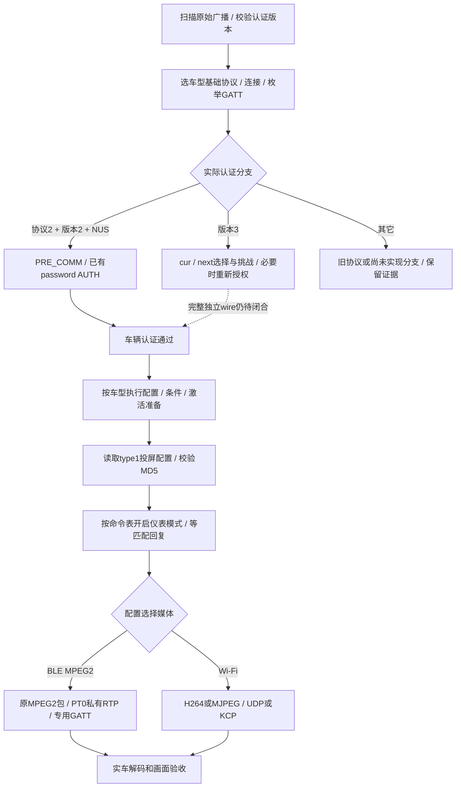

# 九号全仪表连接复现与分阶段发包方案

研究日期：2026-11-15。延续半彩屏BLE媒体链研究，继续分析官方九号出行Android **6.10.11** 的连接、认证、准备、投屏配置与模式开停，并制作独立Android发包探针。多代理分别追官方控制流程、Gen2原密码学与复现、Gen3原生状态机，再交叉复核。

可安装APK、构建/测试与当前证据哈希见[交付验证](../../artifacts/ninebot-connection-repro-20261115/validation-summary.json)。操作见[测试工程README](../../tools/ninebot-ble-test/README.md)。

## 1. 全仪表需要按分支处理

“半彩屏/全彩屏/几寸”不是认证协议判据。同一车型目录条目仍可能由实际广播覆盖认证版本；仪表显示、车辆认证和媒体承载也是不同维度。

| 维度 | 已发现的分支 | 复现时如何判断 |
| --- | --- | --- |
| 基础控制协议 | Protocol1、Protocol2，以及单命令AA55 | 车型配置和实际命令表，不能按年份猜 |
| 车辆认证 | 旧/明文分支、Encryption2、真正V3Auth | 车型基础协议 + 校验后的广播/SDK实际认证版本 |
| GATT控制 | HMSoft FFE0/FFE1、Nordic NUS等 | 实际服务/特征/属性/CCCD；不能按媒体UUID替代 |
| 投屏承载 | BLE、Wi-Fi UDP、Wi-Fi KCP | 当前读取并校验的配置，rtpChannel优先 |
| 视频编码 | MPEG2、H264、MJPEG | codecType优先，否则精确codecName回退 |
| 显示参数 | 尺寸、FPS、码率、布局等 | 实际配置和实车显示，不能统一套240×320 |

本地131条官方车型快照中：110条基础protocol2、7条protocol1、14条缺失；56条含TFT模块。只有三份已解密命令表能证实投屏控制命令。数字是目录覆盖，**不是车型或仪表互通覆盖数**。完整字段与来源见[model-catalog.json](../../artifacts/ninebot-connection-repro-20261115/official-connect/model-catalog.json)。

官方 `DynamicDevice.createBleProtocol` 已用75组合执行原方法核实：

| 基础protocol | 实际认证版本 | 官方类 |
| --- | --- | --- |
| 1 | 2 | BleEncryption2Protocol1 |
| 1 | 其他 | BleProtocol1 |
| 2 | 2 | BleEncryption2Protocol2 |
| 2 | 3 | BleEncryption3Protocol2 |
| 2 | 其他 | BleProtocol2，另受配置encrypt=0影响 |
| 缺失或非1/2 | 任意 | 官方回落BleEncryption2Protocol2 |

测试工具不照搬最后一项的猜测式回落。未知广播、真正V3Auth、Protocol1或缺少NUS时仍能枚举和保存证据，但不会自动发Gen2握手。

## 2. 从连接到显示的完整职责链



图中是职责链。官方某些对象创建、配置加载和准备回调可以交错，不能转写成对所有车型固定延时的包序列。探针将操作拆成显式阶段，避免一个阶段失败后继续发送下一阶段。

状态含义必须分开：

- `gatt_connected`：系统链路连接。
- `authenticated`：Gen2认证有正确来源/命令/成功索引的回复。
- 官方 `prepared`：车型准备处理器完成其配置/条件/激活等检查；探针不伪造此标记。
- `cast_config_md5_verified`：本次车端文件完整校验并完成JSON解析。
- `mode_ack`：收到匹配的仪表模式回复。
- `media_submitted`：有限测试片段的本地写入结束。
- 仪表正确显示：需现场核对，不能由前述任意本地回调替代。

### 2.1 readVersions 的重要收紧

`readVersions` 不能写成每个车型必有的一组车端读取。本轮执行原 `DynamicDevice.onReadVersions` 确认它直接调用listener callback，不读版本寄存器；随后worker才加载VerifyConfig、按条件协商MTU、更新命令条件、检查激活并走prepareSuccess。其他设备类可能重写实际读取，所以这个结论只针对该动态车型分支。

因此“连接后等版本读取成功”不能成为第三方实现的泛化脚本；应逐项恢复本车型准备条件，并以实际收发和状态分开验证。原方法和准备链见[official-connect/notes.md](../../artifacts/ninebot-connection-repro-20261115/official-connect/notes.md)。

## 3. GATT与MTU边界

控制NUS：

```text
service  6e400001-b5a3-f393-e0a9-e50e24dcca9e
write    6e400002-b5a3-f393-e0a9-e50e24dcca9e
notify   6e400003-b5a3-f393-e0a9-e50e24dcca9e
```

官方媒体：

```text
service      6e400001-0000-0000-006e-696e65626f74
RTP write    6e400002-0000-0000-006e-696e65626f74
RTCP write   6e400003-0000-0000-006e-696e65626f74
RTCP notify  6e400004-0000-0000-006e-696e65626f74
```

项目现有 `NinebotVehicleProfile.CUSTOM_*` 与后一组UUID重合；这不足以证明它也能承载Gen2认证。独立探针不自动使用Custom作为认证fallback，亦没有据此修改正式产品行为。当前只在实际NUS服务唯一、写入/通知属性正确且CCCD成功回调后开始Gen2。

控制加密帧：握手前按20字节ATT值分片，认证后可按原始ATT MTU减3。媒体RTP是另一套大小：原始ATT MTU为A，视频片段A−30，完整RTP包A−10；ATT247对应217/237，不是220/240。媒体使用WRITE_NO_RESPONSE，本地回调检查status，不等于仪表确认。

## 4. 独立Gen2已实现的复现流程

新 `NinebotProbeSession` 复用已有 `NinebotEncryption2Codec`，不复制密码学。宿主的单GATT actor负责通知、分片、顺序写、回调、超时和断开。

1. 使用**原始广播名称**和固件初始材料，发送一次PRE_COMM `cmd=0x5B`。
2. 对正确来源的回复取动态auth16字节、SN14字节，按index判断是否已有密码。
3. 未设密码时停止；已有密码但用户未提供时停止；不会自动SET_PWD。
4. 有该车已有16字节password时，设置auth/密钥/计数器并发AUTH `cmd=0x5D`，payload为本会话SN。
5. 只接受来源正确、cmd0x5D/index1及密文校验通过的回复，然后进入authenticated。此时不自动轮询或启动投屏。
6. 可显式只读、读取投屏配置、开停模式。错误来源、完整性失败、重放、counter模式降级、错误分包、GATT错误或超时均结束当前会话。

标准PRE_COMM/AUTH目标为0x04。现有0x09 VCU候选仅有历史PRE_COMM证据，不能把本轮合成AUTH通过说成实车MMAX90已连通；工具让操作者显式选择，不自动扫目标板。

本轮还执行官方原 `libnbcrypto.so` 的 `nb_encrypt`，SHA1/AES/KDF/nonce/tag均跑原ARM64指令，仅桩替libc/TLS。58个场景与独立Python字面量一致，包含原 `setKey(name,null)` 等价固件默认材料的对照；这比仅用同一Java codec充当发送与接收双方更有证据力。它验证发包字节，不验证车端持有的真实密码或接收成功。

具体API、53个独立wire向量、27个Session测试与原函数边界见[Gen2报告](../../artifacts/ninebot-connection-repro-20261115/gen2/notes.md)。

## 5. 投屏配置与模式的可执行字段

以下目前只由Mmax2 `14357`、N3 `14101`、Mz `14360`三份命令表核实：TFT目标/来源板0x23。

| 阶段 | 请求 | 回复处理 |
| --- | --- | --- |
| 文件开始 | cmd0x82，index1，data `01 08 00` | 同cmd，4字节LE文件长度；官方不强制回复index1 |
| 文件分组 | cmd0x83，index=组号，data空 | 同cmd，组内小index从0顺增，每组最多8包 |
| 文件校验 | cmd0x84，index0，data空 | index0，16字节二进制MD5 |
| 地图模式 | cmd0x71，index0，data `02` | 匹配回复；不是显示确认 |
| 停止模式 | cmd0x71，index0，data `00` | 匹配回复 |

type1完整文件MD5包括末尾可能存在的NUL。之后严格UTF-8解码、仅去掉一个末尾NUL，直接作为根JSON对象，不做gzip或base64转换。

分包名义128字节，但不能强制每个非末包都恰好128：原方法对129字节文件接受64+65两包；128+128则原Java数组越界，**没有自动截断填充末包**。探针按 `ceil(fileLen/128)` 计总小包数，允许每包1..128、索引顺序正确、累计不超长、最终精确等长后才请求MD5。它有界拒绝超长，不复制官方越界错误，也不自动重试。

配置选择按：有效rtpChannel→channel→BLE；codecType0/1/2→MPEG2/H264/MJPEG。codecType无效时只把codecName转小写并精确匹配 `mpeg2/h264/mjpeg`，不会用contains。版本按点号前整数首段判断，只有可解析且主版本>5才拒绝；空/不可解析/溢出首段不自动拒绝，这与官方一致。

探针比官方缺省策略更收紧：缺编码尺寸时不回落240×320；只发送与本次配置完全匹配的内置或导入片段。Wi-Fi或非MPEG2配置会保留并展示，但不会误发BLE MPEG2。

## 6. Gen3本轮推进与仍缺的连接环节

### 6.1 认证材料与状态机

四种材料不可混用：本地session UUID、兼容Gen2密码、SDK激活token、按车辆SN授权取得的V3 appEnc。随机UUID或旧密码不能替代appEnc；云响应还含时效、deviceEnc、nonce、aad等分发元数据。

原指令确认 `updateSecret` 将合法32位HEX文本写入 `SN.__next__` 槽；不是直接覆盖cur。空key分支清两个槽。读取后才hex解码，原函数执行确认32位hex得到16字节。

连接时同时读cur/next，next优先；无next才选cur。next成功后只在对应used_key_type分支写cur，写成功再删next；删失败仍可能打印“next removed”，因此不能从该日志单独判定清理成功。挑战过期/失效、回退cur、两槽失败后重新认证都是不同分支。

native Debug枚举 `V2_3` 与 `V3_2` 是不同路径；Java外层认证版本3与内部具体discriminant的完整构造映射尚未执行闭合，不能仅凭名字里的3合并。

### 6.2 快速认证的密码学

本轮已执行原ARM64加密链，并与独立 `cryptography` 实现逐字节对照，确认所分析的快速认证加密函数使用 **AES-128-CCM、8字节nonce、16字节tag，输出ciphertext||tag**。这不是从导入符号猜出的GCM，也不是本地keyring的SHA256/XOR存储形式。

完整原挑战生成器进一步确认34字节payload：

```text
明文：0C 04 [Unix秒低32位，小端4字节]
密文：AES-128-CCM(key16, nonce8, 明文6字节, AAD空) → 22字节
payload：13 16 [密文22字节] 02 08 [nonce8字节]
```

这里使用单字节type/length短TLV；通用parser虽支持长TLV，但不能据通用测试把认证消息改成双字节字段。CLOCK_REALTIME来源有原指令证据；随机填充函数在原函数实验中提供合成8字节输入，不将其称为系统熵源验收。

已新增不依赖SO的纯本地[挑战payload生成模块]（本地来源，未随附原始材料），用冻结原生成器结果校验。它不联网、不发蓝牙、不构成完整Gen3连接器，也不提供Android Gen3发送入口。

这个密码学边界通过不等于已恢复完整BLE Gen3会话。6005挑战的完整TLV、6006回复校验、后续会话计数器/业务帧、有效密钥时的fast路径与失效后的云分发路径仍需分别闭合。新增原函数证据和具体进展以[Gen3报告](../../artifacts/ninebot-connection-repro-20261115/gen3-auth/notes.md)及其机器结果为准。

已定位的fallback涉及6001/6002安全认证、6003/6004密钥分发、6005/6006挑战、6007实体确认。SDK云API有challenge/response/session-key verify/refresh多个边界；**看到这些API不证明每次有效密钥的快速连接都必须联网**。已有合法appEnc的本地fast路径应单独分析，不能把完整重新授权流程套到每次连接。

fast 6006 中key_state=0存在本地成功分支；key_state=1先完成本地成功，再启动另一后台future，其完整语义仍未知。它与full-auth 6006里的云verify上下文不同，不能笼统写“0/1均没有后续联网”或“6006总要先云verify”。

独立Gen3不能靠调用官方SO“变成已独立实现”。本测试APK不包含官方库，也未加入尚未恢复的Gen3发包入口。详见[Gen3交审](../../artifacts/ninebot-connection-repro-20261115/official-connect/cross-review-gen3.md)。

## 7. HCI能验证什么、如何一起发包

完整手机HCI可用于连接、服务发现、MTU、ATT值、应用认证密文、配置/模式和媒体顺序核对。BLE链路加密与App层加密分开：HCI往往可见主机侧ATT值，但App密文不会因为抓HCI自动变明文。

建议两份独立记录：

1. 官方App：从未连接状态开始，正常连接，静置、开启投屏、画面变化、停止和断开。
2. 探针：同一车辆/固件，从扫描到连接逐按钮推进。Gen2无password也可先发PRE_COMM确认响应；有已有password后另起新连接验证AUTH，再读配置和投屏。

不将旧会话密文按时间回放。真实挑战、计数器和密钥槽状态随会话变化；每阶段等待匹配响应，失败则保存日志定位原因。

HCI分析脚本支持H4 btsnoop、ACL/L2CAP重组、固定ATT CID4、请求/应答配对、服务特征UUID与RTP候选识别。截断、drop变化或非法ACL会使未决上下文失效，已消费MTU/服务发现请求不重复使用，避免“漏了一个请求却虚构协商结果”。GATT缓存造成缺少发现过程时，未知handle保持未知。

ADB目前未检测到设备，因此本轮只交付可安装测试包和分析脚本；没有写“已一起实车发包”。下一轮实车最先验证的是实际广播代际、NUS控制特征、PRE_COMM响应和已有凭据AUTH，而不是直接堆视频流。手机HCI和探针NDJSON都能保存每阶段原始收发，方便与上述静态/原函数证据交叉对照。

## 8. 验证、交付与边界

本轮证据分开计数，不把重跑当新增覆盖：

- 官方原Java方法：120个场景、277断言，包括75个协议选择组合、动态版本回调、文件分组/末包、单NUL、MD5、扫描与UUID边界。
- Gen2 Session：27个JUnit场景，53个独立Python wire向量；原ARM64发送加密58场景。
- Gen3：密钥槽/格式选择、hex解码、CCM密码学、提升/回退各自有原指令局部验证；hook边界与未执行路径独立披露。
- Android：Debug APK构建、完整探针单元测试、Lint；没有真机UI/系统蓝牙验收。
- HCI：合成日志布局、分片、丢包、请求配对与广播测试；没有目标车辆抓包。
- 内置媒体：标准FFmpeg生成真实MPEG2包，并由PC FFmpeg解码；不以任意RTP测试向量代替有效视频。

最终数量、APK SHA256、源码哈希、Lint结果与片段解码结果由[validation-summary.json](../../artifacts/ninebot-connection-repro-20261115/validation-summary.json)记录，输入索引见[input-inventory.json]（本地来源，未随附原始材料）。

主要文件：

- [测试工程及安装/采集步骤](../../tools/ninebot-ble-test/README.md)
- [Gen2 Session源码]（本地来源，未随附原始材料）
- [GATT串行宿主]（本地来源，未随附原始材料）
- [HCI分析脚本]（本地来源，未随附原始材料）
- [Gen3本地挑战生成器]（本地来源，未随附原始材料）
- [证据目录](../../artifacts/ninebot-connection-repro-20261115/README.md)
- [前轮BLE媒体链报告](九号半彩屏BLE投屏完整链路与Native复核-20261115.md)
- [Wi-Fi独立实现与分支交叉验证](NinebotPro完整协议分支与交叉验证-20261114.md)
