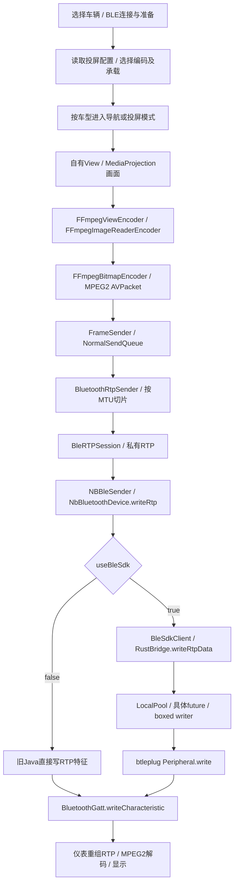

# 九号半彩屏 BLE 投屏：编码、RTP、Rust 与 GATT 完整链路复核

## 1. 本轮得到的结论

**所分析的官方 BLE 媒体路径可以还原为：画面 → FFmpeg MPEG2 编码包 → Java 私有 RTP → 专用 GATT 写入。Rust SDK 在这条路径上透传媒体字节，没有再次封装 RTP，也没有对每个媒体包调用车辆加密函数。**

这比前次“Java 之后进入 native，后续改写/加密未知”推进了一层：本轮找到了具体异步 poll、boxed writer、JNI 调用和 Android `BluetoothGatt.writeCharacteristic`，并执行原 ARM64 函数验证其转发行为。

因此，**这条媒体链没有必须加载九号官方 SO 才能生成的已知私有视频密文格式**。独立实现可以采用 MPEG2 编码器、自写 RTP 和 Android GATT 适配。车辆连接认证、配置读取和开启仪表模式仍是前置控制问题，不能因为媒体直通而跳过。

另有三项需要修正或收紧的旧理解：

- 当前 `Mpeg2CaptureController` 走 `FFmpegBitmapEncoder`，不能只拿旧 `Mpeg2Encoder` 的默认值设计独立发送器。
- `RtpHandler` 确实存在且已定位构造，但其默认 PT32 不代表当前 Java BLE 会话实际发包；当前会话的原类测试确认 PT0。
- 当前主入口显式禁发 Java RTCP；BLE sender 的心跳回调也未像 Wi-Fi sender 一样完整接入。库中有超时字段，不代表当前半彩入口具备心跳失联停流。

“半彩屏”是产品描述，不是唯一协议判据。240×320、MPEG2/BLE 在此前第三方适配中也仍标为待实测；本文没有把它扩展为所有半彩车型已经打通。

## 2. 输入和证据等级

| 输入 | 固定值 |
| --- | --- |
| 官方 App | `cn.ninebot.ninebot`，6.10.11；本地 APK 314,745,290 字节 |
| APK SHA-256 | `02ecd91b74e00df76cfe00eda4c4a9a5bc332231562a171e48d64f45bd418705` |
| ARM64 `librust_lib.so` | 6,804,560 字节；SHA-256 `2ce24100a8c525b575abbf2d53e0f7eee3562d29fec9ad3fe54431bcd9604188` |
| 原方法验证 | dex2jar 转换后的原 DEX 方法，以及原 ELF 的 ARM64 指令；测试桩及截断边界单独披露 |
| native 分析 | `.eh_frame` 函数范围、反汇编、直接调用、RELA vtable、JNI 参数与独立原函数仿真交叉核对 |
| 实车证据 | 本轮无目标仪表 HCI、空口数据或显示验收 |

主代理和三个子代理分别研究控制与验证、Java 编码发送、Rust RTP、GATT 与安全边界，再相互复核。仅出现一个名字、字符串或字段不能证明它参与媒体路径。

完整哈希、输入快照和复跑方式见[证据目录](../../artifacts/ninebot-ble-cast-20261115/README.md)。原 APK、转换 jar、反编译输入和工具依赖保存在本机 Git 忽略目录，不混入产品代码。

## 3. 实际链路与控制层



图中是职责关系；编码器、控制命令和 sender 的创建可在不同准备阶段交错，不能把它当作对任意车型固定延时的一串写入脚本。最后的仪表重组/解码行为尚未由本轮车端证据验证。

### 3.1 配置决定路线

官方配置中 `rtpChannel` 有效时优先，再看 `channel`，仍无效回落 BLE；0/1/2 对应 BLE/WIFI/WIFI_KCP。`codecType` 的0/1/2对应 MPEG2/H264/MJPEG，无有效类型时还可能按 codecName 选择。

编码尺寸优先 codecWidth/Height，再看 dimensionWidth/Height，最后240×320。FPS、码率、GOP、B帧也来自配置。这个缺省不证明所有半彩仪表都是240×320，更不证明全部同尺寸设备具有相同认证版本。

配置仍是此前已恢复的 type1 文件：命令130开始、131数据、132校验，开始payload `01 08 00`，每组最多8×128字节，MD5校验。该文件读取不是视频发送，也不以MD5替代身份认证。

### 3.2 仪表模式开停

`setNaviStart` 的 payload 是单字节：00停止、01 SimpleNavi、02 MapNavi、03 Cruise。此前核过的 Mmax2/N3/Mz 命令表为tft板、cmd0x71/index0；地址必须按车型表确定。

`DashNaviDataMessenger.start` 在存在命令时等待回调，只以 `NbFrame != null` 判断成功。没有该命令时可直接返回true；它不等于仪表已经显示。上层还判断断电状态是否允许导航、设备类型及准备条件，不能把一个02字节写到所有车辆上声称支持。

控制层原证据和本轮复核见[控制与配置笔记](../../artifacts/ninebot-ble-cast-20261115/control-config/notes.md)。

## 4. 半彩画面到底怎么编码

### 4.1 当前入口与旧类的区别

`CaptureClient → CaptureService.createMpeg2Capture → Mpeg2CaptureController`：有 MediaProjection 时创建 `FFmpegImageReaderEncoder`，否则创建 `FFmpegViewEncoder`。两者共用 `FFmpegBitmapEncoder`。旧 `cn.ninebot.capture.mpeg2.Mpeg2Encoder` 仍在 APK 中，但不是这个入口实际实例化的编码器。

可直接绘制的自有主题能走View/Bitmap路径；采用系统录屏路径则需MediaProjection授权。官方在已有Projection时也会用VirtualDisplay/Presentation承载自身导航View，不能把Projection仅解释为录其他App。BLE路径发送的是压缩画面，不能把主题画面直接当JPEG发送到 MPEG2 仪表。

### 4.2 当前编码器的参数

| 项 | 当前 FFmpeg 路径 |
| --- | --- |
| 视频codec ID | 2，MPEG2 video |
| 像素格式 | 0，YUV420P |
| FPS | 配置值，否则10 |
| 码率 | 配置值，否则2,000,000；这不是 BLE 实际吞吐保证 |
| GOP | 配置值，否则5 |
| 最大B帧 | 配置值，否则0 |
| 低延迟/选项 | 请求 forceLowDelay、preset=ultrafast、tune=zerolatency、bitrate_mode=cbr |
| 外部封装 | 没有显式setFormat；目标文件名test.mpg不足以证明媒体线上为PS |

这些是调用请求值；本轮没有在 Android 上执行 FFmpeg 编码来验证每个选项都被实际采用。旧类的200kbps缺省不能代替这里的2Mbps缺省；独立实现应优先使用目标仪表读取的配置，并验证真实吞吐。

### 4.3 RTP拿到的不是任意`.mpg`文件

`NbFFmpegFrameRecorder.writePacket(i==0)` 直接复制 `AVPacket.data/size` 给编码监听器，再释放 packet。当前发送器得到的是编码器产生的视频 AVPacket 字节，不能因为输出流名字是test.mpg，就先加一层MPEG-PS/TS再发。

这提供了“原始 MPEG2 视频编码包进入 RTP”的静态依据；本轮未生成真实编码包，未宣称已测出仪表接受的所有 MPEG2 profile、sequence header和丢片恢复细节。

### 4.4 关键帧标志经历了两次映射

```text
AVPacket.flags & 1 → encoder callback type=1
否则 flags & 4 → callback type=3
否则 → callback type=2

ScreenCastRequest.onEncode:
callback type=1 → sender frameType=2
其他 → sender frameType=3

RTP扩展:
sender frameType=2 → pictureType=1
其他 → pictureType=2
```

因此这里的sender数字2是内部关键帧标记，不能按 FFmpeg `AVPictureType` 的数字2解释成P帧。独立实现应传递语义明确的关键帧标志，再转换线上pictureType。

详见[Java媒体研究](../../artifacts/ninebot-ble-cast-20261115/java-media/notes.md)。

## 5. 队列、切片和重试

`Sender.start`启动发送逻辑后，编码监听器把帧交给 `FrameSender.onData` 和 `NormalSendQueue`，消费者再调用 `BluetoothRtpSender.send`。

`NBBluetoothRtpSender` 设置 `fullQueueCount=3`、`dropFrameThreshold=2`，但覆盖 `isNeedScanQueue()` 返回false。前者仍参与put时的拥堵/丢帧决策；后者不能直接解释为该入口一定启动扫描线程、每2帧触发质量反馈。不能只看setter就给当前会话添加不存在的闭环调速能力。

`NormalSendQueue`的物理容量实际上是30，设置门槛3不会重建队列。原方法验证表明它按关键/非关键帧组合丢弃，并非简单保留最后3帧；`clearBuffer`清队列和多种统计，却没有清`mKeyFrameCount`。接入时应按完整编码帧、参考依赖和关键帧恢复设计有界队列，不能把原计数器原样移植。

必须先定义 `M = device.getMtu()` 的返回值：媒体切片上限为 `M-27`，加20字节RTP后是 `M-7`。SDK getter会先取native报告值U，U>20时再返回`U-3`，否则原样返回；旧BleConnector1也在MTU回调保存`ATT_MTU-3`。**M不能直接当作原始协商ATT MTU。**

正常SDK协商链也已闭合：Android `onMtuChanged`回调原始ATT值A，Integer.intValue将它带回native并存于共享状态，JNI getMtu读取时不扣减，随后Java getter才减3。因此正常协商且A>20时，M=A-3、媒体最多A-30、完整RTP最多A-10。例如A247→M244→媒体217→RTP237。若直接把M设成247做局部split测试，得到220/240只是getter输入案例，不是ATT247的完整连接结果。上述额外余量没有证据属于加密标签或native附加序号，已恢复路径没有插入它们。

本路径以一次RTP数据报对应一次特征写入值，不应在写入前任意拆散。小MTU也不能盲套常数：必须检查 `M-27` 是否有效，并确认native报告值与Android协商值的关系。

`BleRTPSession` 对一次send最多20次尝试。当前 sender 配置的2ms只在失败且还有重试机会时等待，成功包没有固定2ms延时。该重试针对本地发送返回值，不是仪表提供20次RTP确认或选择性重传。

发送结果还有诊断限制：重试耗尽后 `sendData` 仍可能累计统计；`sentOctetCount`也按包加1而不是累加媒体字节；断连时 `NBBleSender.sendRtp` 可以返回true而不实际写入。因此计数、return true或队列清空都不能当作画面成功。

## 6. BLE Java RTP的线上格式

原 `BleRtpPkt.encode()` 直接复用 `RtpPkt`，BLE会话没有将Base默认PT0改成Wi-Fi的32。当前20字节头如下：

| 偏移 | 长度 | 字段 |
| --- | --- | --- |
| 0 | 1 | `90`，RTP v2、X=1、CC=0 |
| 1 | 1 | PT0；最后一片置Marker，变为`80` |
| 2 | 2 | RTP sequence，大端低16位 |
| 4 | 4 | timestamp，大端低32位，当前实现使用系统时间毫秒 |
| 8 | 4 | 会话随机SSRC，大端；不是固定对端编号1 |
| 12..15 | 4 | `00 00 00 01`，扩展ID0，扩展数据长度1个32位字 |
| 16..19 | 4 | `00 01 00 00`或`00 02 00 00`，对应关键/其他pictureType |
| 20.. | ≤M-27 | 同一编码帧的原始字节切片；M是device.getMtu返回值 |

每个编码帧最后一片才置Marker。它没有 Ninebot Pro H.264 的首末位组合、时间低位字段，也不是标准 RFC2250 MPEG视频payload头；不能拿Wi-Fi PT32或JPEG的参数整包套用。

原方法合成向量（关键帧、末片、sequence1234、timestamp01020304、SSRC11223344，payload只用于字段测试）：

```text
90 80 12 34 01 02 03 04 11 22 33 44 00 00 00 01 00 01 00 00 00 00 01 65 7f
```

这不是可播放MPEG2样片。原类测试还复现序号16位回绕附近连续两次线上0的边界；它是原发送器计数行为，不应刻意复制进新实现后当作可靠序号规范。

## 7. JNI之后发生了什么

前次缺口现在已追到具体出口，ARM64地址均针对第2节同一SO：

```text
BleSdkClient.writeRtpData
  → RustBridge.writeRtpData
  → JNI 0x2578a4
  → 0x5dec38：GetArrayLength / GetByteArrayRegion，复制原byte[]
  → 0x637ad4：克隆owned buffer
  → 0x27e7e8 → 0x27e518：LocalPool
  → 0x26bfec，在0x26c08c直接调用0x2eccd8
  → 0x2eccd8：查找RTP characteristic，恢复同一ptr/len
  → 0x5cdaf0：构造boxed writer
  → vtable 0x679010 的poll 0x5bfbc8
  → 0x5b2450：准备Java UUID/byte[]/write-type
  → 0x5c1684：调用 Peripheral.write
  → Android BluetoothGatt.writeCharacteristic
```

`0x2eccd8` 在查找成功后，将原数据指针、原长度传给writer，write-type discriminant=1；等待时保留future状态，恢复后继续。没有读取RTP头来重新切片或替换sequence，也没有在此段写入媒体缓冲。RTP JNI通过LocalPool等待本地writer Future变为Ready后才返回bool，形成逐次提交的等待；不能描述为仅把RTP任务投入后台就立即返回。

主代理另用Unicorn执行该原函数，覆盖13种长度及一组Pending→Resume，14组全通过：UUID、characteristic、指针、长度、全部字节、写入类型均保持；输入区无写操作。它只验证到writer边界，不执行真实GATT。

此前被列为候选stream writer的`0x369e74`已更正：它更新characteristic查找缓存并唤醒等待者，不接收RTP payload，不能把它当作视频封包函数。

native调用与局部仿真原证据分别见[Rust复核](../../artifacts/ninebot-ble-cast-20261115/native-rtp/findings.md)、[原函数验证](../../artifacts/ninebot-ble-cast-20261115/control-config/native-forward-validation.json)。

## 8. `RtpHandler`存在，但不能替代当前包格式

本轮补齐了旧搜索遗漏的Debug thunk：`0x38c150 → 0x385e00`，并从RwLock、Arc、NBBle的Debug类型链定位到构造函数`0x328434`。

对象数据的已确认默认值：payload_size为构造参数低16位，标准头12字节、specific header8字节、index0、SSRC0、PT32、standard=true。调用者依据尚未解释的bool在20/512间选payload_size参数，**不能直接把它称为协商MTU**。

7组原初始化基本块仿真确认上述字段。尚未恢复它的其他packet消费者或运行时index更新逻辑，不能断言该对象永远不用；但当前已闭合的Java `writeRtpData`链不经过它重新封包。

因此这里不再把“native有RtpHandler，可能再改媒体”当作当前路径的阻塞点，也不会拿其PT32覆盖原Java会话已验证的PT0。

## 9. GATT出口和实际写入值

| 用途 | UUID |
| --- | --- |
| 专用媒体服务 | `6e400001-0000-0000-006e-696e65626f74` |
| RTP写入 | `6e400002-0000-0000-006e-696e65626f74` |
| RTCP写入 | `6e400003-0000-0000-006e-696e65626f74` |
| RTCP通知 | `6e400004-0000-0000-006e-696e65626f74` |

这些UUID的后缀不是Nordic NUS的 `b5a3-f393-e0a9-e50e24dcca9e`，不能只见6e400002前缀就当作同一个特征。命令认证的NUS/custom选择，与媒体专用服务应分别建模。

native boxed future把原数据复制成Java byte[]后调用btleplug Android `Peripheral.write(UUID,byte[],int)`。该方法排入串行commandQueue，再对所选特征 `setValue(data)`、`setWriteType(...)`、调用 `BluetoothGatt.writeCharacteristic`；没有在这个Java出口自行插入加密层或切成多个应用包。RTP路径传入1，对应Android `WRITE_TYPE_NO_RESPONSE=1`。

队列有约6秒的操作超时释放逻辑。`onCharacteristicWrite`按UUID结束对应future，未将GATT status完整地作为媒体成功判据。RTP JNI虽等待这个本地Future，仍不等于车机已重组、解码、显示；WRITE_NO_RESPONSE更没有应用层逐包画面确认。Peripheral队列本身无显式容量上限，也不能据此推断这个同步等待的单线程RTP入口一定无界堆积。

旧Java connector的第三参数true也已追到WRITE_NO_RESPONSE；其底层可按自己的MTU值拆过长数组。当前上层已把RTP控制在协商MTU余量内，不能将这种底层兜底分段当作仪表原生视频分片协议。

RTP和RTCP各有特征路由；不能向普通车辆命令特征塞视频，也不能把SDK的RTSP命名回调误读成TCP RTSP会话。

详见[GATT与安全研究](../../artifacts/ninebot-ble-cast-20261115/ble-security/notes.md)。

## 10. 媒体有没有鉴权或加密

应分成三个问题回答：

| 层次 | 本轮结论 |
| --- | --- |
| 车辆连接/准备 | 仍有Gen2/Gen3等连接认证与设备准备流程；不能凭媒体透传省略 |
| 每包媒体应用层 | 当前恢复的writeRtpData链直接发送RTP字节，没有另加车辆AES密文、MAC或自定义加密外壳 |
| BLE链路安全 | Android/controller的配对、bond、链路加密及仪表GATT权限需对应设备确认；App字节明文不等于无线空口一定明文 |

门控也要区分：`BleSdkClient.mConnectedDevice`可在connect进度id0时赋值；SDK CONNECTED状态在成功回调赋值。`NbBluetoothDevice.isConnected()`还涉及 `preparatoryProcessor.isPrepared`，在后续读取版本等准备完成后才置好。上层 `NBBleSender`会使用这个连接判断。

相比之下，低层 `BleSdkClient.writeRtpData`自身只检查非空和MAC是否等于当前设备，不重新执行车辆握手。因此不能以“此函数没有检查认证”断言新手机可以跳过整个车辆会话直接投屏。

本轮针对crypto导入调用者与媒体路径交叉追踪，避免从“库内有crypto_encrypt/decrypt”推出“视频必定逐包AES”。结论限这个版本和这条已恢复的发送路径，不外推所有SDK API、固件或未来车型。

## 11. 心跳、失败和停止

库中存在16字节RTCP APP `mpv\0`心跳、index及超时状态。主入口 `DeviceScreenCastManager.prepare`和Builder构造 `ScreenCastDataSender(device,false)`，`NBBleSender.sendRtcp`因此直接返回true而不发送。

独立创建`NBBleSender`时，其缺省构造值为true，需与上述显式false区分。SDK的RTCP JNI还走另一条Tokio spawn分支，不能把RTP同步等Future的保证套到RTCP；是否发出、订阅通知和接收反馈应分别记录。

RTCP补充路径已静态追到 `0x257548 → Tokio runtime → 0x318a18 → 0x31e420`，目标为专用服务001/写特征003，再进入通用worker。后续consumer还未像RTP一样完整闭合；不能仅用两者相邻的JNI函数名就宣称具有相同处理与返回语义。其Java首次写入还会懒订阅004通知，但忽略订阅bool后标记已订阅，也不证明通知实际生效。

此外，当前 `BluetoothRtpSender`没有覆盖继承的空 `receiveHeartBeatData`，也未像Wi-Fi `RtpSender`那样把BLE会话socketConnectListener完整接到自身状态回调。上层 `DeviceScreenCastRequest`的heartBeat计数主要接收这套媒体状态回调；本轮没有在该类发现独立BLE媒体保活定时器。

故不能把库的“sendIndex-receiveIndex超时”配置表直接当作当前半彩入口必有的失联停流。车辆连接/控制层可能另有保活和断连处理，属于另一条状态机。

停止涉及编码器、帧队列、sender、RTCP线程/监听和仪表模式控制等不同资源；本地释放和仪表停止显示不是同一条回执。正式实现需统一连接代次、取消等待、清积压、重新同步关键帧，避免恢复时播放旧帧或把本地回调当车端确认。

高层onStop会先clearQueen再stop，但直接调用BLE sender.stop并不等于清空队列、唤醒阻塞take或等待线程退出；已进入sendData的一帧仍可能继续重试。也未见BLE stop发送Wi-Fi式BYE。编码资源中当前ImageReader包装器与旧Mpeg2Encoder的显式释放范围有差别，详见分支笔记；本轮未做Android泄漏实测。

## 13. 验证、交叉审查与待实车项

| 验证 | 本轮结果与范围 |
| --- | --- |
| Java队列/切片原方法 | 570条断言；原NormalSendQueue/Frame、BluetoothRtpSender及split方法，环境桩捕获会话参数 |
| Java BLE RTP原类 | 15条断言、10组场景；原classes12编码/会话方法，本地sink，不运行RTCP网络线程 |
| ARM64 RTP转发 | 14组；执行原0x2eccd8，hook特征查询/环境克隆，writer边界截获 |
| ARM64 handler初始化 | 7组；只执行原0x328b70..0x328ba8基本块，不能当作handler消费者验证 |
| ARM64 writer/JNI边界 | 24组分段仿真；原boxed writer、Java数组转换包装、JNI实参构造，JVM动作是显式hook |
| JNI/GATT与加密边界 | 原指令、vtable、Java出口和crypto调用者的独立静态交叉核查；不冒称实车测试 |

跨代理复跑同一工具只增加独立审阅，不重复增加覆盖。dex2jar原类在JVM运行的stackmap/环境桩限制、ASM保留的方法范围、Unicorn的hook均在证据说明中列出。

尚需目标车验证：实际codec/dimension/FPS/码率配置、GATT权限与MTU、首次连接及已绑定连接的前置认证、开停模式、真实MPEG2码流、丢片后恢复、后台与断连重连，以及画面是否正确显示。Gen3完整认证状态机和其他RtpHandler消费API也未由本轮媒体链逆向全部闭合。

本轮已把原先的“native媒体是否再封装/逐包加密未知”收敛为明确的透传路径；剩余的设备认证与实车兼容性应按独立问题继续验证。

## 14. 证据与历史对照

- [本轮证据说明和复跑](../../artifacts/ninebot-ble-cast-20261115/README.md)、[输入哈希]（本地来源，未随附原始材料）
- [Java媒体笔记](../../artifacts/ninebot-ble-cast-20261115/java-media/notes.md)、[队列/切片验证](../../artifacts/ninebot-ble-cast-20261115/java-media/validation.json)、[原BLE会话验证](../../artifacts/ninebot-ble-cast-20261115/java-media/session-validation.json)
- [Rust RTP调用链](../../artifacts/ninebot-ble-cast-20261115/native-rtp/findings.md)、[原ARM64验证](../../artifacts/ninebot-ble-cast-20261115/control-config/native-forward-validation.json)
- [GATT/认证/加密边界](../../artifacts/ninebot-ble-cast-20261115/ble-security/notes.md)、[控制与配置](../../artifacts/ninebot-ble-cast-20261115/control-config/notes.md)
- [writer/JNI分段仿真](../../artifacts/ninebot-ble-cast-20261115/ble-security/gatt-boundary-validation.json)、[Java复核native](../../artifacts/ninebot-ble-cast-20261115/java-media/cross-review-native.md)、[Native复核Java](../../artifacts/ninebot-ble-cast-20261115/native-rtp/cross-review-java.md)、[安全分支复核主代理](../../artifacts/ninebot-ble-cast-20261115/ble-security/cross-review-root.md)、[主代理复核安全分支](../../artifacts/ninebot-ble-cast-20261115/control-config/cross-review-security.md)
- [前轮九号投屏与加密汇总](九号投屏链路与加密研究汇总-20260922.md)、[官方静态缺口续研](NinebotEnhance非导入APK投屏可行性复核-20261009.md#86-ble-native-入口及本次验证范围)
- [前轮Gen3认证研究](九号Gen3与2025后车型蓝牙握手深度研究-20261009.md)、[Ninebot Pro Wi-Fi协议对照](NinebotPro完整协议分支与交叉验证-20261114.md)
